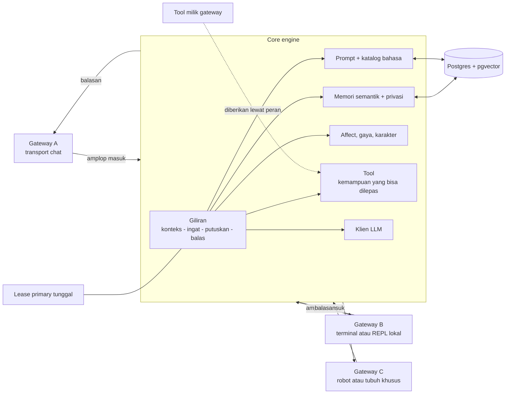

<p align="center">
  
</p>

<h1 align="center">Eidesoul</h1>

<p align="center"><em>mesin jiwa: satu diri, selalu ingat, selalu belajar, orang yang sama di mana pun ia hidup.</em></p>

<p align="center">
  <a href="docs/v0.1.0/README.md"></a>
  <a href="LICENSE"></a>
  <a href="#status-hari-ini"></a>
  <a href="pyproject.toml"></a>
  <a href="#credits"></a>
  <a href="README.md"></a>
  <a href="README.id.md"></a>
</p>

<p align="center">
  <a href="#architecture">Arsitektur</a> · <a href="#quickstart">Mulai cepat</a> ·
  <a href="#soulyaml">soul.yaml</a> · <a href="#character-library">Pustaka karakter</a> ·
  <a href="#supported-gateways">Gateway</a> · <a href="#roles-and-permissions">Peran dan izin</a> ·
  <a href="#safety">Keamanan</a> · <a href="#credits">Kredit</a>
</p>

<a id="status-hari-ini"></a>
## Status hari ini

Engine, konsol CLI, gateway WhatsApp (extra opsional), memori, affect, dan guard sudah jalan hari ini.
Panel web dan installer on-machine masih rencana, belum dibangun. Sisa berkas ini menggambarkan desain
target; bagian ini adalah selisih yang berjalan sekarang.

<a id="apa-arti-slogan-ini"></a>
## Apa arti slogan ini

- **satu diri** — satu identitas dan satu memori per jiwa, bukan sesi. Proses di-restart, permukaan
  diganti: diri yang sama tetap berlanjut.
- **selalu ingat** — yang penting dicatat: fakta tentang orang, siapa diri jiwa itu sendiri, tugas yang
  sudah selesai, dan apa yang baru saja dikerjakan. Fakta membawa tingkat privasi dan bisa diveto oleh
  orang yang menjadi subjeknya, identitas hidup di satu dokumen soul alih-alih di prompt, dan yang
  dibicarakan orang yang sama di satu tubuh bisa dilanjutkan di tubuh lain, karena memori milik jiwa dan
  orangnya, bukan milik transport. Lupa adalah keputusan (retensi, decay), bukan kecelakaan.
- **selalu belajar** — saat sebuah tugas selesai, worker membaca episode-nya dan bisa menulis prosedur
  yang bisa dipakai ulang dengan rujukan ke asalnya. Belajar mengubah prosedur, tidak pernah aturan,
  persona, atau izin — dan ia berjalan secara default.
- **orang yang sama di mana pun ia hidup** — sebuah tubuh membawa giliran: terminal, aplikasi chat,
  perangkat, robot. Chat adalah satu tubuh, bukan kelas dasar. Asisten adalah satu peran di antara
  pendamping, penasihat, dan perwujudan robot; mengganti peran mengubah apa yang boleh dilakukan jiwa,
  bukan siapa dirinya.

Memori adalah lantainya, bukan seluruh jiwa. Emosi punya engine sendiri: state PAD dengan baseline
kepribadian yang meluruh antar-giliran, drive yang berdenyut, dan relasi per orang yang bergerak lewat
tahap. Konteks juga punya engine sendiri: fakta dipilih secara semantik tiap giliran, dan gerakan
karakter diambil dari pack dengan gerbang register dan tingkat kasar, jadi apa yang ia tahu dan
bagaimana ia bicara disusun, bukan diimprovisasi. Pacing yang dimanusiakan adalah timing di atasnya.

Clean by default berlaku untuk gateway, tool, dan plugin: masing-masing mati sampai diaktifkan, dan
spine satu-satunya pengecualian. Lapisan suara — emosi, humanize, karakter — aktif secara default,
`init` menanyakannya sekali, dan tiap bagiannya bisa dimatikan.

<a id="di-mana-posisinya"></a>
## Di mana posisinya di antara harness

Agent adalah model plus harness. Harness adalah runtime di sekitar model: ia menjalankan pemanggilan
tool, menjaga state dan konteks, menerapkan approval, dan menjaga pekerjaan tetap bergerak. Harness
dinamai menurut tujuannya — autonomous harness agent berjalan tanpa pengawasan, developer harness agent
mengubah sebuah repository — dan yang sudah matang sudah membawa memori, skill, todo, dan aturan
approval.

Eidesoul adalah **soul harness**: harness yang state-nya adalah diri. Ia mengingat lintas sesi, menjaga
satu persona, dan berperilaku sebagai satu karakter yang meyakinkan lintas setiap embodiment.

| | Di mana state hidup | Bagaimana satu giliran mendapat konteks | Dioptimalkan untuk |
|---|---|---|---|
| Autonomous harness agent | riwayat tugas dan workspace-nya, cukup untuk melanjutkan dari titik terakhir | context window, dipadatkan saat penuh | menyelesaikan pekerjaan tanpa pengawasan |
| Developer harness agent | repository dan berkas-berkasnya | context window, diisi dari berkas dan keluaran tool | mengubah kode dengan benar |
| Eidesoul (soul harness) | satu store kanonik — Postgres dengan index vektor — memuat memori, affect, dan transkrip | dibangun ulang setiap giliran dari store itu, dibatasi pada orang dan chat; window hanya working set, bukan memorinya | tetap orang yang sama, serba bisa — ingat, belajar, privasi, izin |

Harness konvensional memperlakukan context window sebagai memori kerja lalu memadatkannya saat penuh. Di
sini store adalah memorinya dan window hanya working set giliran ini, jadi percakapan panjang tidak
bergantung pada apa yang masih muat. Tingkat privasi, veto oleh orang yang menjadi subjek fakta, dan izin
berbasis role adalah sifat store itu, bukan sifat prompt.

<a id="apa-yang-coba-diselesaikan"></a>
## Apa yang coba diselesaikan

Hampir semua produk agent menabrak sepuluh dinding yang sama. Tiap paragraf menyebut apa yang biasanya
terjadi, lalu apa yang dilakukan engine ini.

**Asisten yang lupa.** Bangunan biasanya memulai setiap sesi dari prompt kosong: riwayat adalah transkrip
yang Anda tempel kembali, dan "memori" adalah apa pun yang masih muat. Di sini setiap giliran menulis
kandidat fakta ke Postgres, model memberi label berupa tingkat privasi numerik, pemilik, dan subjek, dan
giliran berikutnya mengambilnya lewat pencarian vektor pgvector melalui Mem0, dibatasi pada orang,
thread, atau seluruh jiwa. Pertanyaan tentang keputusan bulan lalu bergantung pada apa yang tersimpan,
bukan pada apa yang masih muat di window.

**Percakapan yang melampaui window.** Jawaban biasanya pemadatan: ringkas giliran tertua, buang, lanjut.
Yang dibuang hilang, dan ringkasan menjadi satu-satunya jejak. Di sini arsip adalah rekamannya dan window
adalah tampilan: tiap giliran menyusun working set dari arsip — ekor terbaru plus rantai kutipan pesan
yang sedang dijawab — di bawah budget karakter, lalu membuang working set itu lagi. Satu thread bisa
berjalan berbulan-bulan tanpa model memegang semuanya.

**Karakter yang bergeser.** Bangunan biasanya mengirim system prompt per klien: bot WhatsApp punya satu
kepribadian, widget web lain, CLI lain lagi, masing-masing dengan riwayatnya sendiri. Di sini satu dokumen
soul berwenang di database dan dicerminkan ke disk; setiap tubuh membaca dokumen yang sama dan memori
yang sama, jadi terminal, aplikasi chat, perangkat, dan robot berbicara sebagai satu orang. Tubuh
menambah transport dan aksinya sendiri; ia tidak pernah menambah kepribadian.

**Memori yang bocor.** Vector store biasanya satu index per bot: pengambilan mengembalikan apa pun yang
paling mirip, termasuk fakta privat dari ruangan lain. Di sini tiap entri membawa tingkat privasi 0
sampai 4, pemilik yang menyatakannya, dan subjek yang dibicarakannya; pengambilan hanya menyentuh
global, orang ini, dan thread ini; grup membatasi levelnya; subjek bisa memveto entri; dan keputusan
pengungkapan bersifat deterministik, dibuat sebelum model mana pun melihat teksnya. Model hanya diminta
memberi label sementara dan merangkai pertanyaan konfirmasi.

**Agent yang bertindak tanpa otoritas.** Loop biasanya menyetujui semuanya otomatis, atau menenggelamkan
operator dengan pertanyaan. Di sini izin hanya datang dari role — entri yang tidak ada berarti menolak —
dan aksi sensitif melewati guard deterministik lebih dulu; hanya yang tak bisa diklasifikasi lapisan itu
yang sampai ke model kecil dan cepat. Target menentukan kelasnya: lingkup sendiri meminta persetujuan
peminta, lingkup bersama atau luar meminta role approver, dan bukti lingkup dihitung ulang saat eksekusi
sehingga role yang melebar membuka ulang approval.

**Dua instance, satu jiwa.** Deployment biasanya naik ke dua replika, keduanya menjawab, keduanya
menulis, dan penulis terakhir menang. Di sini satu baris lease di Postgres yang memutuskan: pemegangnya
primary, instance lain standby dan beku, dan takeover adalah peristiwa database dengan jejak audit, bukan
kecelakaan deployment.

**Giliran yang mati di tengah.** Loop biasanya menjalankan tool, crash, dan restart mengulang efek
sampingnya. Di sini pesan dan gilirannya masuk antrean dalam satu transaksi, giliran adalah baris dengan
checkpoint langkah, dan pengiriman dicatat per potongan. Restart melanjutkan dari checkpoint, mengirim
ulang hanya yang belum terkirim, menjalankan ulang tool hanya kalau ia idempoten, dan menandai aksi
non-idempoten yang sudah dieksekusi sebagai interrupted alih-alih mengulanginya. Penulisan arsip yang
gagal menggagalkan giliran secara terbuka; tidak ada yang dilaporkan tersimpan padahal tidak.

**Tebakan yang menjadi aturan.** Fitur memori biasanya membiarkan agent menulis catatan ke promptnya
sendiri, dan giliran berikutnya catatan itu terbaca seperti instruksi operator. Di sini tulisan turunan
wajib membawa rujukan ke sumbernya, penurunan dibatasi satu tingkat, dan aturan hanya boleh diekstrak
dari dokumen soul. Memori baru mulai dalam karantina, butuh korroborasi sebelum bisa dibaca, dan tidak
pernah mengubah izin.

**Balasan yang mengarang apa yang tidak diketahuinya.** Model biasanya menjawab dari prompt dan mengisi
celah dengan percaya diri. Di sini lapisan pengetahuan memilih fakta terkurasi tiap giliran — kemiripan
embedding atas pack terkurasi, dengan fallback kata kunci saat vektor tidak ada — jadi prompt membawa
fakta bersumber, bukan kira-kira. Pass karakter boleh menulis ulang nadanya; ia tidak boleh mengubah
fakta, angka, nama, atau hasil tool, dan kalau hasilnya mencurigakan, draf aslinya yang dipakai.

**Balasan yang terdengar seperti mesin.** Perbaikan biasanya system prompt "jadilah ramah", yang
menghasilkan paragraf datar yang sama untuk semua orang. Di sini emosi adalah engine sendiri: state PAD
dengan baseline kepribadian yang meluruh antar-giliran, drive seperti energi, kebosanan, dan kesepian
yang berdenyut seiring waktu, dan relasi per orang yang bergerak lewat tahap dengan inersia dan batas
laju. Engine konteks memilih gerakan karakter dengan gerbang register dan tingkat kasar, dan pass
humanize mengatur pacing balasan. Semuanya sakelar — aktif default, ditanyakan sekali saat init — jadi
deployment yang menginginkan suara datar bisa mematikannya.

Tidak satu pun dari ini trik prompt. Masing-masing adalah tempat state hidup, dan aturan siapa yang boleh
mengubahnya.

<a id="architecture"></a>
## Arsitektur

Tiga lapisan, satu arah ketergantungan.

- **Core engine** — giliran plus layanan yang dibutuhkannya: penyusunan prompt, katalog bahasa,
  memori semantik dan privasi, affect dan gaya, klien LLM, serta eksekusi tool. Core tidak pernah
  mengimpor gateway, pustaka transport, atau SDK vendor secara eager.
- **Kontrak gateway** — setiap transport mengimplementasikan antarmuka kecil yang sama:
  menormalkan pesan masuk menjadi satu amplop, menyerahkannya ke engine, lalu mengantarkan balasan.
  Gateway adalah plugin. Mereka ditemukan berdasarkan nama, dan satu deployment hanya mengaktifkan
  yang diinginkannya.
- **State** — satu database menyimpan satu jiwa: transkrip per percakapan, memori semantik dengan
  tingkat privasi, affect, approval, dan lease primary tunggal. Berkas host (`config.yaml`,
  `roles.yaml`, `soul.yaml`) adalah seed sekaligus cermin dari apa yang disimpan database.



Lease adalah cara satu proses tetap menjadi primary: instance tanpa lease tetap beku dan standby,
sehingga dua proses tidak pernah bicara dengan mulut yang sama. Semua yang diketahui jiwa
tersimpan, jadi restart, deployment yang dipindah, atau tubuh yang berbeda melanjutkan jiwa yang
sama, bukan memulai yang baru.

<a id="tools-are-capabilities"></a>
## Tool adalah kemampuan

Tool adalah kemampuan yang bisa diberikan kepada jiwa, bukan tubuh yang tetap. Tubuh menentukan
kemampuan mana yang ada; peran menentukan mana yang boleh dipakai jiwa di tubuh itu.

Enam keluarga inti hanyalah contoh, bukan taksonomi yang harus dipenuhi: `shell`, `read`, `write`,
`web_search`, `sandbox`, dan `mcp`. Itu mencakup kasus umum — menjalankan perintah, membaca berkas,
mencari di web, memanggil server MCP — dan tidak lebih.

Robot, perangkat, atau gateway khusus mengekspos aksi khas tubuhnya sebagai modul tool milik
gateway, berdampingan dengan gateway yang memberi makna pada aksi itu. Kamera, motor, printer, atau
bus otomasi rumah adalah milik perwujudan, bukan milik engine. Peran memberikan tool tersebut secara
eksplisit, jadi peran pendamping di ponsel tidak pernah mewarisi kendali sebuah robot.

Engine tidak pernah meng-hardcode tubuh dan tidak pernah meng-hardcode loop agent. Tidak ada planner
yang perlu dikonfigurasi, tidak ada task graph yang diluncurkan, tidak ada kawanan di latar
belakang: satu jiwa, satu giliran, dan kemampuan yang dipegang saat itu.

<a id="quickstart"></a>
## Mulai cepat

Kebutuhan: Python 3.12, Postgres 14+ dengan `pgvector`, dan endpoint LLM yang kompatibel dengan
OpenAI. Image container sudah memakai Python 3.12; menjalankan dari source di 3.11+ juga bisa.

```bash
# 1. Scaffold config.yaml, roles.yaml, soul.yaml, dan .env; provider adalah pilihan operator
eidesoul init --provider openai

# 2. Jadikan ini jiwa Anda, bukan jiwa default
$EDITOR soul.yaml

# 3. Isi .env: kunci provider, URL database, dan POSTGRES_PASSWORD untuk compose
#      EIDESOUL_DATABASE_URL=postgresql+psycopg://eidesoul:<password>@127.0.0.1:5432/eidesoul
#      POSTGRES_PASSWORD=<password yang sama>
#      OPENAI_API_KEY=...

# 4. Satu database untuk satu jiwa; compose.yaml membaca POSTGRES_PASSWORD dari .env
podman compose up -d postgres

# 5. Buat skema dan seed berkas host ke dalamnya
eidesoul db upgrade

# 6. Jalankan gateway yang diaktifkan di config.yaml
eidesoul run

# REPL lokal terhadap jiwa dan database yang sama; mengambil lease
eidesoul console --takeover
```

`eidesoul run` memuat dokumen, mengambil lease primary, lalu menjalankan gateway yang aktif.
Instance kedua tetap standby dan beku sampai mengambil alih lewat lease, jadi
`eidesoul console --takeover` adalah cara resmi berbicara manual dengan deployment yang sedang
berjalan.

`eidesoul db check` mencetak ringkasan skema dan isi; `eidesoul selftest` menguji store, tool, dan
LLM sekali tanpa menjalankan gateway. `eidesoul people list` menampilkan identitas dan alamat
gateway-nya, dan `eidesoul people adopt` memindahkan alamat lama (nomor telepon, `local`) ke id
`per_…`, ikut membawa state affect dan style-nya serta menulis ulang dokumen peran; ia idempoten,
jadi deployment yang di-upgrade cukup menjalankannya sekali.

`uv sync` memasang tulang punggung kemampuan: penyimpanan Postgres+pgvector, memori Mem0, embedder
multibahasa, prototipe affect, dan guard. Hanya transport dan integrasi yang berupa extra:

| Extra | Membawa | Dibutuhkan untuk |
|---|---|---|
| `whatsapp` | Neonize + segno | gateway WhatsApp |
| `google` | Google API client, google-auth, httpx | tool Google Workspace |

```bash
uv sync --extra whatsapp --extra google
```

Setiap extra bisa dilepas: tidak ada bagian core yang mengimpornya secara eager, dan tanpa extra,
tool atau gateway terkait menjelaskan mengapa ia inert.

<a id="soulyaml"></a>
## soul.yaml

Satu database adalah satu jiwa, dan `soul.yaml` adalah tempat jiwa itu dituliskan. Semua kunci
kecuali `name` opsional; kunci yang tidak dikenal diabaikan. Setelah `db upgrade` pertama, jiwa yang
tersimpan di database menjadi acuan dan `soul.yaml` adalah seed sekaligus cerminnya — ubah berkasnya,
jalankan `eidesoul config import` untuk memasukkan perubahan, atau `eidesoul config export` untuk
menuliskan cerminnya kembali.

```yaml
name: Eidesoul                  # wajib; jika kosong jatuh ke "Eidesoul"
description: ""                 # satu baris, muncul di blok persona
language: id                    # katalog terpasang: id | en
pronouns: aku
gender: unspecified             # male | female | nonbinary | unspecified
role: assistant                 # peran aktif
roles: [assistant]              # opsional; default [role]
locale: id-ID                   # locale konteks untuk prompt dan currents
background: ""                  # teks bebas: asal-usul jiwa ini
persona: ""                     # markdown bebas: kepribadian, suara, nilai
style:                          # ditulis `eidesoul library resolve`, bukan manual
  patterns: []                  # id pack pattern dari eidesoul/library/patterns/
  facts: []                     # id pack fakta dari eidesoul/library/facts/
  registers: []                 # allow-list register opsional; kosong = default pack
  max_patterns: 0               # gerakan pattern per giliran, 0..6
  max_facts: 0                  # fakta per giliran, 0..6
examples: []                    # opsional [{user: "...", soul: "..."}]
```

Aturan yang ditegakkan loader:

- `name` harus tidak kosong, jika tidak dipakai nilai default.
- `gender` harus salah satu dari `male`, `female`, `nonbinary`, atau `unspecified`; nilai lain
  jatuh ke `unspecified` dengan peringatan.
- `roles` default `[role]` bila tidak diisi; jika `role` tidak ada di `roles`, ia ditambahkan di
  depan, dan persona hanya mencantumkan peran lain bila jumlahnya lebih dari satu.
- Id pack dan register harus cocok dengan `^[a-z0-9][a-z0-9-]{0,63}$`; id tidak valid adalah error,
  bukan dilewati diam-diam.
- `max_patterns` dan `max_facts` dijepit ke `0..6`.
- `persona` dirender dengan urutan tetap: nama, deskripsi, peran aktif, peran tersedia, locale,
  background, persona bebas, lalu contoh dialog. Bagian kosong dihilangkan.
- `style` diturunkan: `eidesoul init` mengisinya dan `eidesoul library resolve --force` menulis
  ulang dari `description` + `background` + `persona` + `examples`, hanya memakai pack yang
  `language`-nya sama dengan jiwa. Kecocokan lemah, seri, atau kosong tidak memilih apa pun, dan
  jenis yang tidak menemukan padanan mempertahankan pack yang sudah ada.

Peran aktif dan pack gaya adalah dua tombol yang membentuk satu giliran. Peran aktif menentukan izin
dan sikap kerja; pack gaya menentukan bagaimana jiwa terdengar dan seberapa banyak data karakter
yang boleh dipakai per giliran. Jiwa tanpa pack tidak meminjam gaya bahasa daerah dan tidak memakai
fakta — hanya `persona` dan `background` miliknya sendiri.

Contoh singkat (biarkan `style` ditulis resolver):

```yaml
name: Eidesoul
language: id
role: companion
roles: [assistant, companion]
locale: id-ID
background: |
  Tumbuh di sekitar pelabuhan yang ramai dan masih berpikir dengan cerita dermaga.
persona: |
  ## Kepribadian
  Lugas, kering, hangat setelah kepercayaan terbentuk.
style:
  patterns: [jawatimur]
  facts: [indonesia]
  max_patterns: 3
  max_facts: 2
examples:
  - user: "capek banget hari ini"
    soul: "sini dulu, duduk"
```

<a id="character-library"></a>
## Pustaka karakter

Data karakter adalah pustaka yang dipilih jiwa, bukan sesuatu yang dikirim engine lewat suaranya.
Seleksi berjalan dari atas ke bawah: `soul.yaml` menyebut pack-nya, `eidesoul init` mengisi daftar
itu sesuai bahasa jiwa, dan `eidesoul library resolve` menurunkannya kembali dari tulisan penulis.
`style` kosong berarti tanpa pattern dan tanpa fakta.

Pack berada di bawah `eidesoul/library/`:

- `patterns/<pack>.json` — gerakan bersyarat ("jika begini, maka begitu") yang ditandai register,
  target gender, serta gate toksisitas dan konten dewasa. Satu pack membawa `version`, `model`,
  `language`, sebuah `lexicon` token percakapan, dan baris `patterns`.
- `facts/<pack>.json` — fakta pendek yang berdasar, masing-masing dengan setidaknya satu URL
  sumber. Satu pack membawa `version`, `model`, `language`, dan baris `facts`.

Dua pack disertakan sebagai contoh kerja: `jawatimur` (gerakan percakapan Jawa Timur) dan
`indonesia` (fakta Indonesia). Pilih keduanya, abaikan, atau tulis sendiri:

```yaml
style:
  patterns: [jawatimur]
  facts: [indonesia]
  registers: [serious, laughter]   # opsional: hanya register ini
  max_patterns: 3
  max_facts: 2
```

Seleksi bersifat deterministik per giliran: engine membaca pesan terakhir, menurunkan register
ruangan, lalu memilih paling banyak `max_patterns` gerakan dan `max_facts` fakta. Hit kata kunci
didahulukan, lalu kemiripan kosinus pada embedder bersama (`eidesoul/engine/embed.py`). Pack yang hilang, tidak
terbaca, atau namanya di luar pola id tidak menyumbang apa pun dan mencatat peringatan alih-alih
menggagalkan giliran.

Tidak ada transkrip mentah yang dikirim. Baris `say` di pack pattern adalah contoh yang sudah
disetujui, bukan pesan pribadi yang disalin, dan baris fakta membawa sumber, bukan percakapan.

Ubah pack lewat skrip, jangan manual:

```bash
python scripts/patterns.py --pack jawatimur --check     # skema, gate, duplikat, keterjangkauan
python scripts/patterns.py --pack jawatimur --embed     # bangun ulang vektor pack
python scripts/fakta.py --pack indonesia --check        # skema dan vektor
python scripts/fakta.py --pack indonesia --embed
python scripts/grow.py --pack jawatimur --patterns      # usulkan baris baru dari korpus
```

`--embed` harus dijalankan setelah setiap perubahan konten agar vektor sesuai dengan barisnya. Pack
baru adalah pasangan berkas baru di direktori yang sama dengan nama yang cocok dengan pola id; tidak
perlu mengubah kode untuk memilihnya.

<a id="supported-gateways"></a>
## Gateway yang didukung

Inilah daftar lengkapnya; tidak ada bagian lain dalam dokumentasi yang mendaftar gateway.

- **CLI** — bawaan. Config default mengaktifkannya, dan inilah cara `eidesoul run` serta
  `eidesoul console` berbicara dengan sebuah jiwa tanpa transport jaringan.
- **WhatsApp** — extra opsional. Pasang dengan `uv sync --extra whatsapp` dan aktifkan di bagian
  `gateways`; hilangkan keduanya dan gateway ini tidak ada untuk deployment tersebut. Core tidak
  pernah mengimpornya, dan peran member default tidak pernah menerima tool `send` miliknya.
- **Perwujudan Anda sendiri** — robot, loop suara, perangkat, atau endpoint HTTP privat hanyalah
  gateway lain. Implementasikan amplop masuk dan antarmuka gateway, kirim kelasnya sebagai entry
  point di grup `eidesoul.gateways` atau aktifkan berdasarkan nama, dan ia bergabung ke jiwa yang
  sama.

Gateway adalah transport, bukan otak. Ia menormalkan input, mengantarkan balasan, dan memiliki modul
tool khas tubuh yang ingin dieksposnya. Tool milik gateway diberikan ke peran secara eksplisit,
sama seperti tool inti.

<a id="roles-and-permissions"></a>
## Peran dan izin

Izin hanya datang dari peran. Setiap peran mendaftar `tools` dan `commands` miliknya sendiri; tidak
ada handler yang membawa default, jadi peran yang menghilangkan satu bagian ditolak untuk seluruh
bagian itu. Satu `roles.yaml` menyimpan semua peran, dan peran yang tersimpan di database menjadi
acuan dengan berkas sebagai cerminnya.

```yaml
roles:
  member:
    priority: 10
    users: []
    tools: [read, web_search, sandbox, memory, google]
    commands: [help, ping, link, unlink, whoami, status, tools]
    context: ""
    memory_admin: false
  owner:
    priority: 100
    users: ["per_xxxxxxxxxx"]
    tools: ["*"]
    commands: ["*"]
    memory_admin: true
```

- `tools` dan `commands` menerima nama persis dan `*`. Daftar yang tidak ada berarti menolak semua.
- Izin tool diperiksa di satu tempat, saat tool dieksekusi, sehingga tool yang terlihat tetapi tidak
  diberikan tidak bisa berjalan.
- `approve` adalah izin command seperti yang lain: hanya peran yang mencantumkannya bisa
  menyelesaikan aksi yang tertunda.
- `memory_admin: true` wajib untuk menulis memori global jiwa.
- Peran mencantumkan identitas opaque `per_…` (`eidesoul people list`), bukan nomor telepon atau
  JID: `person_links` memetakan tiap alamat gateway ke identitas itu, `/link` menautkan gateway
  kedua ke orang yang sama, dan `/unlink` melepasnya. Identitas di beberapa peran digabung;
  blok `context` diurutkan berdasarkan priority, lalu name.
- Cakupan workspace mengikuti pemberian yang sama: peran tanpa `*` melihat area bersama yang
  read-only dan area scratch miliknya, dan sandbox mencerminkan itu dengan mount bersama read-only
  serta satu mount scratch yang bisa ditulis.

Mengedit `roles.yaml` secara manual didukung: jalankan `eidesoul config import` setelahnya agar
database melihatnya.

<a id="safety"></a>
## Keamanan

Dua mekanisme terpisah, keduanya fail-closed.

**Approval.** Aksi sensitif — `shell`, `sandbox`, dan perubahan `settings` internal — melewati
kebijakan keamanan sebelum berjalan. `approval.mode` default-nya `yolo` (setujui otomatis, untuk
deployment satu operator yang tepercaya), `strict` menahan setiap aksi non-read-only, dan `off`
mematikan pemeriksaan sepenuhnya. `off` adalah risiko yang didokumentasikan, bukan kemudahan: tidak
ada apa pun antara model dan host. `/approve` menyelesaikan aksi yang tertunda, tidak pernah memanggil
LLM, dan memeriksa ulang izin peran lebih dulu.

**Sandbox guard.** Setiap perintah yang mencapai tool `sandbox` melewati dua lapisan, berurutan:

1. *Deterministik.* Satu set aturan tetap menolak pola keluar dari host dan pola destruktif —
   menghapus filesystem, menulis ke device, tool kernel dan namespace, kendali container dan
   firewall, pipe fetch-to-shell, eskalasi hak, manajemen layanan, dan fork bomb klasik. Perintah
   read-only sederhana langsung diizinkan tanpa panggilan model. Selain itu dianggap belum pasti.
2. *Classifier.* Hanya perintah yang belum pasti yang sampai ke classifier LLM kecil dan cepat
   dengan timeout pendek. Ia menjawab satu pertanyaan: apakah perintah ini mencoba keluar,
   menyerang infrastruktur, mengeksfiltrasi rahasia, menetap, atau menghancurkan data host? Yang
   tidak dikenal dianggap mencurigakan.

Verdict menentukan siapa yang boleh lanjut. Perintah yang diblokir lapisan deterministik ditolak
untuk semua orang, termasuk approver. Perintah yang tertunda atau mencurigakan menjadi approval
tertunda bagi peran yang memegang `approve`, dan ditolak langsung untuk peran lain — member tidak
pernah tertahan di antrean yang tidak bisa ia selesaikan. `approved=True` dari `/approve` melewati
kedua lapisan, setelah pemeriksaan ulang izin. Jika classifier tidak tersedia, timeout, atau
mengembalikan sesuatu yang tidak bisa diurai, hasilnya tertutup: tertunda untuk approver, ditolak
untuk peran lain. Perintah yang lebih panjang dari `guard.max_command_chars` diperlakukan sama.

`guard.enabled: false` mematikan kedua lapisan; sandbox lalu menjalankan apa pun yang diberikan.
Pakai hanya saat men-debug sebuah aturan, jangan di deployment yang menerima input tidak
terpercaya. Log mencatat verdict, alasan, dan percakapan — tidak pernah isi perintah.

Sandbox sendiri berjalan di container sekali pakai dengan hanya mount bersama dan scratch, di
jaringan internal khusus di belakang proxy egress, dengan timeout, batas PID, memori, dan CPU.
Tujuan privat diblokir di proxy, jadi sebuah perintah tidak bisa mencapai host atau jaringan lokal
bahkan ketika ia diizinkan berjalan.

<a id="optional-integrations"></a>
## Integrasi opsional

```bash
uv sync --extra whatsapp --extra google                 # gateway dan integrasi opsional
```

```bash
docker build --build-arg EXTRAS="--extra whatsapp --extra google" .
```

Memori, embedder, dan prototipe affect adalah bagian dari instalasi core; tidak ada extra untuk
mereka. Di SQLite, Mem0 tidak aktif dan `status` melaporkan alasannya.

- **Vibe affect** membaca embedder bersama terhadap `eidesoul/library/affect/*.json`; tanpa embedder
  suasana ruangan tetap netral, bukan menebak.
- **WhatsApp** (`whatsapp`): gateway opsional. Tidak pernah aktif secara default.
- **Google Workspace** (`google`): tool in-process untuk berkas yang dibagikan ke service account,
  dengan penautan identitas per pengirim. Tanpa extra ini tool tetap terdaftar tetapi inert dan
  mengembalikan error yang jelas, bukan traceback.

Rahasia hanya boleh ada di `.env`. `config.yaml`, `roles.yaml`, `soul.yaml`, dan `.env` tidak pernah
di-commit.

<a id="credits"></a>
## Kredit

Setiap komponen di bawah ini mempertahankan lisensi dan atribusinya masing-masing. Versinya adalah
yang dipasang lock file; kolom terakhir menjelaskan untuk apa Eidesoul memakainya.

| Komponen | Lisensi | Penulis / organisasi | Sumber | Dipakai untuk |
|---|---|---|---|---|
| Python | PSF-2.0 | Python Software Foundation | https://www.python.org/ | runtime |
| SQLAlchemy | MIT | Michael Bayer / SQLAlchemy authors | https://www.sqlalchemy.org/ | penyimpanan |
| psycopg | LGPL-3.0-only | Daniele Varrazzo | https://psycopg.org/ | driver Postgres |
| psycopg-pool | LGPL-3.0-only | Daniele Varrazzo | https://www.psycopg.org/ | pool koneksi |
| pgvector | PostgreSQL | pgvector contributors | https://github.com/pgvector/pgvector | kolom vektor |
| openai-python | Apache-2.0 | OpenAI | https://github.com/openai/openai-python | klien LLM |
| MCP Python SDK | MIT | Model Context Protocol authors | https://github.com/modelcontextprotocol/python-sdk | tool MCP |
| PyYAML | MIT | Kirill Simonov / PyYAML authors | https://pyyaml.org/ | berkas config + soul |
| ddgs | MIT | ddgs authors | https://github.com/deedy5/ddgs | web search |
| Mem0 (`mem0ai`) | Apache-2.0 | Mem0 | https://github.com/mem0ai/mem0 | memori semantik |
| sentence-transformers | Apache-2.0 | UKP Lab / Hugging Face | https://github.com/huggingface/sentence-transformers | embedding |
| paraphrase-multilingual-MiniLM-L12-v2 | Apache-2.0 | sentence-transformers | https://huggingface.co/sentence-transformers/paraphrase-multilingual-MiniLM-L12-v2 | bobot embedder |
| PyTorch | Apache-2.0 AND Apache-2.0 WITH LLVM-exception AND BSD-2-Clause AND BSD-3-Clause AND BSL-1.0 AND ISC AND MIT AND Zlib | Meta / PyTorch contributors | https://github.com/pytorch/pytorch | runtime tensor |
| Transformers | Apache-2.0 | Hugging Face | https://github.com/huggingface/transformers | pemuatan model |
| Neonize | tidak dinyatakan upstream | krypton-byte | https://github.com/krypton-byte/neonize | transport WhatsApp |
| segno | BSD-3-Clause | Lars Heuer | https://github.com/heuer/segno | pemasangan QR |
| google-api-python-client | Apache-2.0 | Google | https://github.com/googleapis/google-api-python-client | tool Workspace |
| google-auth | Apache-2.0 | Google | https://github.com/googleapis/google-auth-library-python | autentikasi Google |
| httpx | BSD-3-Clause | Encode | https://github.com/encode/httpx | klien HTTP |
| emotion-engine | MIT | PioneerJeff Labs | https://github.com/pioneerjeff-labs/emotion-engine | engine affect yang di-vendor |
| EmoSense-ID classifier | lihat model card | Aardiiiiy | https://huggingface.co/Aardiiiiy/EmoSense-ID-Indonesian-Emotion-Classifier | acuan kalibrasi saja |
| pytest | MIT | pytest authors | https://github.com/pytest-dev/pytest | dev |
| pytest-cov | MIT | pytest-cov authors | https://github.com/pytest-dev/pytest-cov | dev |
| ruff | MIT | Astral | https://github.com/astral-sh/ruff | dev |

<a id="license"></a>
## Lisensi

Eidesoul dirilis di bawah [Apache License 2.0](LICENSE). Hak cipta 2026 Abdul Muqsith.

Komponen pihak ketiga mempertahankan ketentuannya masing-masing; tabel di atas mencantumkan lisensi,
penulis, dan sumber tiap komponen. Emotion engine yang di-vendor membawa lisensinya di samping
source-nya sebagai `eidesoul/vendor/LICENSE.emotion-engine`.
