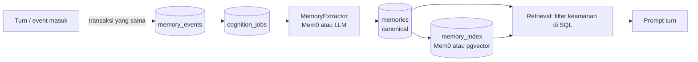

> Terjemahan turunan — jangan sunting; sumber: engine/0001-memory-source-of-truth.md (sha256: 522cee758fff)
> Teks ini ditulis manusia; baris yang tidak bisa diterjemahkan mesin disalin apa adanya ke sumber English, jadi sumber bercampur dua bahasa.

# ADR-0001: Sumber Kebenaran Memori — Postgres Canonical, Mem0 sebagai Memory Intelligence

- **Status:** accepted
- **Implementation:** implemented — evidence: kanonik `memories`/`memory_events`/`memory_uses`/`memory_index`/`memory_tombstones`, `MemoryStore` port tulis tunggal dengan baca hanya view, Mem0 jadi extractor/index, rekey, veto, forget/purge, seam intake, retry/backoff/dead-letter capture di `cognition.py`, dan eval recall/precision (`tests/test_memory_eval.py`: recall 1.0, precision 1.0, duplicate rate 0.0 atas 12 kasus); gate: `pytest -q` 831 lulus, `scripts/adr.py --check`
- **Tanggal:** 2026-11-01
- **Deciders:** Muqsith (owner), omp (reviewer)
- **Konteks:** sesi review arsitektur Eidesoul commit `5dc004c`; diskusi lanjutan soal memori default-on dan peran Mem0
- **Supersedes:** —
- **Terkait:** ADR-0002 … ADR-0008 (antrean keputusan), laporan `Eidesoul-Review-Arsitektur-2026-11-01.md`
- **Amandemen:** 2026-11-02 — normalisasi kerangka (ADR-0009 §4.4): menambah Konfigurasi, Metrik dan gate, Interaksi dengan ADR lain; menomori ulang bagian sesudahnya. 2026-11-03 — audit: judul §14 diselaraskan dengan isinya (antrean + status, bukan "pertanyaan terbuka") dan daftar `kind` job di antrean disamakan dengan ADR-0003 §5.4 (`capture`/`consolidate`/`reflect`/`backfill`/`audit`). 2026-11-03 — keputusan pemilik: DDL `memories` dipindah ke **ADR-0016** (satu DDL kanonik, constraint supersede-aware), antrean §14 menambah ADR-0016, dan **`AGENTS.md` diamandemen**: `MemoryStore` menjadi port tulis tunggal (larangan "never revive" diganti larangan jalur semantik kedua). 2026-11-03 — nama antrean diseragamkan: `memory_outbox` → `cognition_jobs` (diagram, tabel, tahap implementasi). 2026-11-03 — antrean §14 ikut memakai istilah **Lapis 1/2** untuk payload ADR-0015. 2026-11-03 — keputusan pemilik: **Mem0 wajib** (spine), opsi B2 "lepas Mem0" dinyatakan **ditolak** (§3/§4/§7 disesuaikan); `mem0_history.db` ditetapkan sebagai cache library derived (`memory/mem0.py:157-182`) dan `AGENTS.md` mendapat klausa eksplisit untuk cache library. 2026-11-03 — berkas itu dinyatakan memuat teks
(termasuk yang dihapus), sehingga purge/`forget` wajib membersihkan salinannya (ADR-0005 §4.5). 2026-11-03 — audit: rujukan skema paket `mem0ai` (`history`/`messages`) ditambahkan pada klaim isi berkas.
- **Catatan lokasi:** ADR hidup di `docs/v0.1.0/adr/engine/`; salinan Indonesia di `docs/v0.1.0/adr/engine/id/0001-memory-source-of-truth.md`.

---

## 1. Konteks

- Memori saat ini praktis default-off: auto-capture hanya berjalan bila role memiliki tool `memory` (`agent.py:614,906-921`), dan capture bersifat fire-and-forget tanpa retry maupun status.
- Mem0 adalah pemilik data sekaligus metadata keamanan (level, owner, subject, veto, audience) di payload JSONB, bukan di skema yang kita kontrol.
- Akibat yang terverifikasi di review:
  - rekey identitas menghidupkan kembali entri yang sudah di-veto dan mengubah audience (`memory/rekey.py:15-62`);
  - `set_privacy` tidak punya otorisasi (`memory/mem0.py:496-525`);
  - level privasi tidak memfilter retrieval, hanya output/audit (`memory/context.py:127-131`, `memory/privacy.py:52-71`);
  - Mem0 gagal init → `NullMemory`, bot tetap membalas tetapi tidak ingat (`memory/__init__.py:131-188`);
  - tidak ada migrasi skema, RLS, retention, atau audit yang bisa diandalkan.
- Tujuan produk: memori adalah spine jiwa — harus durable, auditable, bisa dilupakan dengan benar, dan tetap konsisten lintas tubuh/gateway.

## 2. Decision drivers

1. **Durabilitas.** Memori tidak boleh hilang karena library gagal.
2. **Konsistensi.** Capture sebaiknya satu transaksi dengan penyimpanan pesan/event.
3. **Keamanan.** Level, owner, subject, veto, audience harus menjadi kolom yang bisa di-query, diuji, dan di-`WHERE`.
4. **Operasional.** Backup, migrasi, retention, audit, dan rebuild index.
5. **Time-to-value.** Jangan membangun ulang mesin ekstraksi/consolidasi tanpa bukti.
6. **Kebebasan keluar.** Mem0 harus bisa diganti tanpa mengubah pemanggil.
7. **Batasan.** `AGENTS.md` menyatakan “Semantic memory only through Mem0”; keputusan ini mengubah maknanya, bukan menghapus Mem0.

## 3. Opsi yang dipertimbangkan

| Opsi | Bentuk | Konsekuensi | Status |
|---|---|---|---|
| **A. Mem0 canonical + outbox** | Postgres hanya antrean; Mem0 tetap pemilik data | Cepat; kehilangan data tertahan di outbox; tetapi metadata keamanan tetap di library, rekey/veto/level tetap rapuh, migrasi/RLS tetap tidak mungkin | Ditolak sebagai target |
| **B1. Jalur 1 — Postgres canonical + Mem0 sebagai intelligence/index** | `memories` milik kita; Mem0 menjalankan ekstraksi/konsolidasi dan pencarian semantik di balik port; index dapat di-rebuild | Durabel, transaksional, bisa di-query/RLS/migrasi; bug metadata hilang; tetap memakai nilai Mem0; menambah outbox, rekonsiliasi, dan port | **Dipilih** |
| **B2. Jalur 2 — Lepas Mem0** | Postgres canonical termasuk `vector(384)` + HNSW; ekstraksi/dedupe/ranking milik sendiri | Kontrol penuh dan satu store; tetapi kita memiliki kualitas ekstraksi, dedupe, ranking, dan eval | **Ditolak**: Mem0 wajib di spine (AGENTS) |
| **C. Mem0 sebagai index bisu** | Canonical Postgres, tetapi Mem0 hanya menyimpan vektor | Dependency tetap ada, nilai intelligence tidak dipakai | Ditolak |
| **D. Status quo** | Mem0 canonical penuh | Paling sedikit perubahan, tetapi tidak layak untuk data yang diklaim sebagai inti jiwa | Ditolak |

Alasan B2 ditolak: Mem0 adalah bagian **spine yang wajib**, bukan pilihan implementasi — `AGENTS.md` menyebutnya dapat dicabut hanya lewat perubahan spine, bukan lewat jalur implementasi. Yang tersulit memang bukan kolom vektor melainkan prompt ekstraksi, dedupe/conflict resolution, ranking/hybrid search, versioning embedding, dan evaluasi; karena Mem0 wajib, pekerjaan itu tetap milik Mem0 dan kita hanya menjaga kontraknya.

## 4. Keputusan

> **Own the record, rent the intelligence.**

- **Postgres adalah system of record.** Tabel `memories` adalah sumber kebenaran untuk fakta, level keamanan, kepemilikan, veto, dan retensi.
- **Mem0 adalah `MemoryExtractor` + `MemoryIndex` di balik port.** Ia tetap melakukan pekerjaan yang paling bernilai: mengubah percakapan menjadi fakta terstruktur, dedupe/consolidasi, dan pencarian semantik.
- **Index dan hasil ekstraksi dapat di-rebuild dari canonical.** Derived store boleh hilang; canonical tidak.
- **Keputusan keamanan tinggal di canonical**, difilter di SQL sebelum ranking.
- **Mem0 tidak dipakai sebagai index bisu.** Kalau intelligence-nya tidak lagi dipakai, yang diperbaiki adalah adapter (atau spine diubah lewat ADR baru yang mengubah `AGENTS.md`), bukan mempertahankannya sebagai vektor penyimpan.

## 5. Arsitektur target

Rencana tabel:

| Tabel | Peran | Sifat |
|---|---|---|
| `memory_events` | Jurnal mentah capture (pesan/observasi) | Immutable, ditulis satu transaksi dengan pesan |
| `cognition_jobs` | Antrean pekerjaan ekstraksi/index (nama lama: `memory_outbox`) | Idempotent, retry, status terlihat |
| `memories` | Fakta canonical + metadata keamanan | Source of truth |
| `memory_index` | Vektor untuk pencarian semantik | Derived, bisa di-rebuild |

Bentuk final kolom, constraint, dan index `memories` ada di **ADR-0016 §4.2-§4.3** (satu DDL
kanonik). ADR ini memegang daftar tabel dan perannya; kolom yang lahir di ADR turunan (`state`,
`level`, `confirmed` di ADR-0004; retensi di ADR-0005; provenance/trust di ADR-0008; dispute di
ADR-0010) tidak ditulis ulang di sini, supaya tidak ada dua versi yang bisa menyimpang.

Invariant yang harus diuji:

- `extra` tidak pernah bisa menimpa kolom keamanan (`level`, `owner_id`, `subject_id`, `vetoed`, `audience`).
- Filter retrieval selalu menyertakan `vetoed = false` dan scope yang diizinkan; level difilter sebelum prompt untuk ruang non-DM.
- `forget` menghapus baris canonical **dan** entri index; audit menyimpan tombstone tanpa isi.
- Rekey identitas hanya `UPDATE memories SET person_id = …`; veto/audience/level/confirmed ikut terbawa.

## 6. Konsekuensi

**Positif**

- Memori tidak lagi hilang diam-diam saat Mem0/Postgres bermasalah.
- Veto, level, audience, owner/subject menjadi kolom yang bisa diuji; rekey menjadi operasi SQL.
- Backup, migrasi, dan audit kembali normal (satu Postgres, Alembic).
- Mem0 tetap dipakai untuk hal yang sulit dan bernilai.
- Port menjaga Mem0 di balik antarmuka: mengganti versi atau adapter tidak menyentuh pemanggil, dan spinenya tetap wajib.

**Negatif**

- Menambah pekerjaan: outbox, worker, idempotency, rekonsiliasi, status.
- Ada dua tulisan (canonical + derived); index bisa tertinggal.
- Bentuk output Mem0 tetap menjadi ketergantungan pada lapisan adapter; perlu test kontrak dan pin versi.
- Perlu eval set untuk menilai kualitas ekstraksi/retrieval.
- `AGENTS.md` harus diubah: Mem0 tetap mesin semantik, tetapi bukan pemilik data.

**Netral**

- `mem0_history.db` (SQLite) tetap ada selama Mem0 dipakai: **cache internal library**, derived, path-nya ditetapkan adapter (`memory/mem0.py:157-182`), tidak pernah dibaca engine sebagai kebenaran, dan aman hilang. Berkas itu memuat `old_memory`/`new_memory` (skema paket `mem0ai`: tabel `history` dan `messages`)
(termasuk teks yang sudah dihapus) dan `messages.content`, jadi ia **tunduk pada aturan purge ADR-0005**:
"aman hilang" berarti boleh dihapus kapan saja, bukan boleh menyimpan jejak. `AGENTS.md` memberi klausa
eksplisit untuk cache library seperti ini.
- Ekstraksi tetap memanggil LLM; biaya dan latensi harus diukur, bukan diasumsikan.

## 7. Implementasi bertahap

| Tahap | Isi | Gate penerimaan |
|---|---|---|
| **0** | Perbaiki P0 privasi: pre-filter L3/L4, veto subject, rekey mempertahankan metadata | Test privasi hijau; tidak ada L4 di prompt grup |
| **1** | `memory_events` + `cognition_jobs`; capture satu transaksi; retry + status | Mem0 mati → capture masuk antrean; `/status` menunjukkan backlog; tidak ada kehilangan |
| **2** | Mirror fakta hasil ekstraksi ke `memories`; retrieval memfilter kolom canonical | Rekey/veto/level lulus test; retrieval memakai filter SQL |
| **3** | Port `MemoryStore`/`MemoryExtractor`/`MemoryIndex`; perintah `memory reindex`; eval set | Recall/precision terukur; rebuild idempotent |
| **4** | Evaluasi kualitas Mem0 sebagai extractor (prompt/adapter disetel; Mem0 tetap karena spine wajib) | Keputusan berbasis data biaya/latensi/kualitas |

Catatan urutan: **default-on dan klaim “menyimpan” baru boleh dinyalakan setelah tahap 0 dan 1 selesai.**

## 8. Perubahan dokumen dan aturan

- **`AGENTS.md`**: nyatakan Postgres sebagai system of record memori; Mem0 sebagai `MemoryExtractor`/`MemoryIndex`; perjelas pengecualian terhadap “Semantic memory only through Mem0” dan aturan “tools are removable”.
- **`TASK.md`**: tambah item canonical store, outbox, reindex, eval.
- **`LOG.md`**: catat ADR ini sebagai perubahan arsitektur, bukan sekadar fitur.
- **`README.md`**: jelaskan storage default, recall selektif, disclosure terkontrol; jangan klaim “selalu ingat”.
- **ADR home**: pindahkan ADR ke `docs/adr/` dan izinkan di `AGENTS.md` lewat ADR terpisah.

## 9. Konfigurasi

ADR payung ini tidak punya kunci konfigurasi sendiri; kunci konkret (pemicu capture, batching, retention, privasi grup, dan seterusnya) hidup di ADR turunannya masing-masing.

## 10. Metrik dan gate

Ambang dan metrik (recall/precision, backlog, biaya/latensi ekstraksi) didefinisikan di ADR turunan masing-masing, bukan di sini. Gate penerimaan per tahap implementasi ada di §7.

## 11. Acceptance criteria

- [ ] Capture tidak hilang saat Mem0/Postgres bermasalah; ada retry dan status.
- [ ] `memories` adalah satu-satunya sumber kebenaran fakta dan metadata keamanan.
- [ ] Index dapat dibangun ulang dari canonical tanpa kehilangan fakta.
- [ ] Rekey identitas mempertahankan `vetoed`, `audience`, `level`, `confirmed`.
- [ ] Subject dapat mem-veto fakta tentang dirinya, dari scope mana pun.
- [ ] L3/L4 tidak masuk prompt non-DM tanpa persetujuan.
- [ ] `forget` menghapus canonical dan index; tombstone audit tanpa isi.
- [ ] Eval recall/precision tersedia dan dijalankan di CI.
- [ ] Tidak ada monkey-patch internal library tanpa pemeriksaan versi.

## 12. Risiko dan mitigasi

| Risiko | Mitigasi |
|---|---|
| Index drift (derived tertinggal) | Outbox + idempotency key + job rekonsiliasi + `memory reindex` |
| Lock-in pada ekstraksi Mem0 | Port `MemoryExtractor`; prompt ekstraksi sendiri disiapkan sebagai fallback |
| Privasi: isi percakapan dikirim ke LLM ekstraksi | Hard exclusion (kredensial/krisis), kebijakan retensi, dokumentasi operator |
| Biaya/latensi ekstraksi per turn | Prefilter deterministik sebelum assess; batching; metrik biaya |
| Kerusakan saat migrasi | Shadow index + bandingkan hasil sebelum swap; canonical tidak diubah |
| Mem0 mengubah bentuk payload | Pin versi, test kontrak adapter, parsing defensif |

## 13. Interaksi dengan ADR lain

ADR ini adalah ADR payung yang menaut ADR turunan; antrean keputusan dan status masing-masing ADR ada di §14, sedangkan interaksi dokumen dan aturan (mis. `AGENTS.md`, `README.md`) ada di §8.

## 14. Antrean keputusan dan status ADR

Antrean nomor dan status ADR tinggal di satu tempat: **`docs/v0.1.0/README.md`** (indeks rumah
ADR, ADR-0009). Daftar panjang di bagian ini tidak lagi dirawat di sini.

## 15. Referensi kode

- `eidesoul/engine/memory/__init__.py:131-188` — `NullMemory`, `build_memory`.
- `eidesoul/engine/memory/mem0.py:139-203` — `available`, config, monkey-patch client.
- `eidesoul/engine/memory/mem0.py:246-290` — `_metadata` dan urutan merge.
- `eidesoul/engine/memory/mem0.py:496-531` — `set_privacy`, `veto`.
- `eidesoul/engine/memory/rekey.py:15-62` — `RESERVED`, `_move`.
- `eidesoul/engine/memory/context.py:127-131` — filter retrieval.
- `eidesoul/engine/privacy.py:222-303` — capture dan assess.
- `eidesoul/engine/agent.py:614,906-921` — gate `can_memory` dan spawn capture.
- `eidesoul/engine/stores/affect.py` — pola state document yang bisa ditiru untuk `memory_events`.

---

*ADR ini disimpan di `docs/v0.1.0/adr/0001-memory-source-of-truth.md`.*
