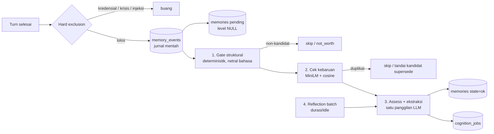

> Terjemahan turunan — jangan sunting; sumber: engine/0002-capture-trigger.md (sha256: 8e04667ce755)
> Teks ini ditulis manusia; baris yang tidak bisa diterjemahkan mesin disalin apa adanya ke sumber English, jadi sumber bercampur dua bahasa.

# ADR-0002: Pemicu Capture — Gate Deterministik, Cek Kebaruan, Assess Batch

- **Status:** accepted
- **Implementasi:** implemented — bukti: `memory/gate.py` (gate struktural + dedupe), `memory/assess.py` (assess batch), kebaruan di `memory/store.py` memakai embedder 384-d bersama, seam intake terhubung ke `cognition_jobs`, `tests/test_cognition.py`; hasil gate: `pytest -q` 648 lulus
- **Tanggal:** 2026-11-01
- **Deciders:** Muqsith (owner), omp (reviewer)
- **Konteks:** lanjutan ADR-0001 (Postgres canonical + Mem0 sebagai `MemoryExtractor`/`MemoryIndex`) dan rencana memori default-on
- **Supersedes:** —
- **Terkait:** ADR-0001 (sumber kebenaran), ADR-0003 (cognition worker & batching), ADR-0004 (fallback labeling), ADR-0008 (integritas), ADR-0010 (reflection)
- **Amandemen:** 2026-11-01 — hard exclusion dipindahkan ke **sebelum** `memory_events` ditulis (kredensial/krisis/instruksi berbahaya tidak pernah dipersistensi di jurnal memori); gate struktural dievaluasi saat job; baris canonical dibuat `pending` dengan `level NULL` (ADR-0004), diagram dan acceptance sudah diselaraskan. 2026-11-02 — di percakapan grup, capture dibatasi pada pernyataan pembicara tentang dirinya; fakta pihak ketiga dan balasan soul sendiri tidak di-capture otomatis (ADR-0006). 2026-11-03 — audit: rentang rujukan `embed.py:17-80` diperbaiki menjadi `16-66` (berkas 66 baris). 2026-11-03 — nama antrean di diagram: `memory_outbox` → `cognition_jobs`. 2026-11-03 — audit: `rate_limit_per_chat_hour` dihapus dari `capture`; kuota volume satu angka, milik ADR-0008 §4.4A.
- **Catatan lokasi:** ADR hidup di `docs/v0.1.0/adr/engine/`; salinan Indonesia di `docs/v0.1.0/adr/engine/id/0002-capture-trigger.md`.

---

## 1. Konteks

- Capture sekarang bersyarat dan tidak konsisten: hanya jika role punya tool `memory`, panjang pesan ≥ `capture_min_chars` (default 8), bukan krisis, bukan injection, bukan `SENSITIVE`, privacy assess mengembalikan JSON, lalu `spawn()` fire-and-forget (`agent.py:614,906-921`, `privacy.py:222-303`).
- Rencana memori default-on akan membuat capture berjalan setiap turn. Tanpa gerbang, setiap turn memicu assess LLM + ekstraksi Mem0 — dua panggilan LLM tambahan di atas 4–6 panggilan yang sudah ada.
- Prefilter berbasis kata kunci Indonesia akan melanggar prinsip “any body/language” dan aturan `AGENTS.md` (tidak ada string non-Inggris di kode).
- Capture default-on juga memperbesar permukaan memory poisoning: teks dari sumber yang tidak tepercaya bisa masuk memori dan memengaruhi turn berikutnya.

## 2. Decision drivers

1. **Biaya** — capture tidak boleh menggandakan biaya turn.
2. **Recall** — fakta penting tidak boleh terlewat.
3. **Precision** — memori tidak boleh penuh basa-basi, duplikat, dan status sesaat.
4. **Netral bahasa** — aturan gate tidak boleh bergantung kosakata satu bahasa.
5. **Determinisme** — gate harus testable; keputusan yang bisa dihindari LLM jangan diserahkan ke LLM.
6. **Privasi & keamanan** — hard exclusion tetap berlaku; data belum dilabeli tidak boleh diungkap.
7. **Kesederhanaan operasional** — satu jalur real-time ringan + satu jalur batch yang sama untuk semua kerja kognitif.

## 3. Opsi yang dipertimbangkan

| Opsi | Bentuk | Kelebihan | Kekurangan | Status |
|---|---|---|---|---|
| **A. Selalu assess** | Setiap turn → assess → extract | Recall maksimal; sederhana | Biaya ~2×; noise; antrean panjang; permukaan poisoning besar | Ditolak |
| **B. Prefilter + assess** | Gerbang deterministik → assess untuk kandidat | Biaya terkendali | Bisa melewatkan fakta implisit; tanpa mekanisme pemulihan | Ditolak sebagai bentuk final |
| **C. Model memutuskan** | Soul memanggil tool `memory` bila merasa perlu | Tidak perlu assess otomatis | Tidak konsisten; model bisa lupa; soul dibebani tugas mengingat | Ditolak sebagai jalur utama |
| **D. Hybrid bertingkat** | Gate struktural → cek kebaruan (MiniLM) → assess+ekstraksi LLM untuk kandidat novel → store; pemulihan lewat reflection batch | Murah; netral bahasa; deterministik di tahap awal; recall dipulihkan berkala | Paling kompleks; bergantung pada kualitas threshold | **Dipilih** |

## 4. Keputusan

**Capture adalah pipeline empat tahap dengan dua jalur: real-time ringan dan batch berkala.**



### Tahap 1 — Gate struktural (tanpa model)

Dijalankan langsung saat turn, murah dan deterministik:

- bukan command, bukan pesan sistem, bukan hasil tool;
- panjang minimum (`min_chars`);
- dedupe hash per `(thread_id, message_id, kind)`;
- rate limit per chat per jam;
- hard exclusion: kredensial/secret, crisis, instruksi berbahaya, teks yang terdeteksi injection;
- provenance dicatat (`source`, `trust`) untuk ADR-0008.

Gate ini **tidak** memakai kosakata bahasa. Kalau nanti perlu sinyal leksikal, ia harus hidup sebagai data per bahasa di `lang/`, bukan konstanta di engine.

### Tahap 2 — Cek kebaruan (MiniLM, tanpa LLM)

- Pakai vektor MiniLM yang sudah ada; bila memungkinkan, **pakai ulang embedding turn yang sama** sehingga biaya tambahannya nol.
- Bandingkan dengan memori `person`/`chat`/`global` yang relevan di canonical + index.
- Kemiripan ≥ `novelty_threshold` → kandidat sudah dikenal:
  - teks sama → skip;
  - teks berbeda tetapi topik sama → tandai sebagai kandidat `supersedes`, diselesaikan reflection (ADR-0010), bukan di jalur real-time.
- Novel ≠ layak: tahap ini hanya menyaring duplikat, bukan memutuskan nilai.

### Tahap 3 — Assess + ekstraksi (satu panggilan LLM)

- Hanya untuk kandidat novel. Satu panggilan mengembalikan JSON tervalidasi:

```json
{
  "worth": true,
  "level": 2,
  "subject": "nama atau id",
  "facts": [
    {"kind": "preference", "text": "...", "supersedes": "uuid atau null"}
  ]
}
```

- Gabungan assess dan ekstraksi dipilih untuk menghemat satu panggilan per kandidat. Kalau hasilnya terbukti lebih buruk, pemisahan kembali adalah perubahan kecil yang dicatat di ADR terpisah.
- Rubrik yang diajarkan ke model:
  - **Layak:** preferensi, identitas, hubungan, komitmen, jadwal berulang, aturan, konteks kerja yang bertahan.
  - **Tidak layak:** basa-basi, status sesaat, pertanyaan tanpa fakta, hasil tool, rahasia/kredensial, instruksi terhadap sistem.
- Instruksi prompt berbahasa Inggris; input boleh bahasa apa pun; `subject` dikembalikan apa adanya.
- Validasi per item, retry per item, dan kegagalan mengikuti ADR-0004 (default: simpan raw `unconfirmed`, konservatif, tidak diungkap sampai dilabeli).

### Tahap 4 — Pemulihan lewat reflection batch

- Backfill **tidak** dijalankan di jalur real-time dan tidak menjadi bagian rilis pertama.
- Fakta yang terlewat gate akan dipulihkan oleh reflection berkala atas `memory_events` (ADR-0010), dengan satu jalur batch yang sama seperti capture.
- Ini menjaga prinsip: satu mekanisme batch untuk semua kerja kognitif.

### Tool `memory`

- Tetap ada, tetapi hanya untuk aksi sadar: “ingat ini”, koreksi, `forget`, `veto`, `export`.
- Bukan jalur utama capture; soul tidak perlu memilih untuk ingat.

## 5. Konfigurasi

```yaml
memory:
  capture:
    mode: balanced          # off | conservative | balanced | eager
    min_chars: 8
    # kuota volume tulis (per chat / per orang): satu angka, di ADR-0008 §4.4A
    novelty_threshold: 0.88
    combine_assess_and_extract: true
```

- `off` → kill switch operator.
- `conservative` → hanya kandidat dengan sinyal kuat.
- `balanced` → default.
- `eager` → mendekati “selalu assess”, untuk operator yang menerima biaya.

## 6. Konsekuensi

**Positif**

- Mayoritas turn tidak menambah panggilan LLM; hanya kandidat novel yang memicu satu call.
- Gate netral bahasa; tidak ada daftar kata Indonesia di engine.
- Tahap 1–2 deterministik dan bisa diuji tanpa LLM.
- Recall tetap punya jalur pemulihan (reflection), tanpa membebani real-time.

**Negatif**

- Fakta yang lolos gate baru masuk memori setelah reflection; ada jendela keterlambatan.
- Threshold kemiripan perlu kalibrasi dan bisa salah dalam dua arah.
- Menggabungkan assess + ekstraksi menambah coupling; perlu dipantau dengan eval.
- Reflection menjadi ketergantungan recall; kalau dinonaktifkan, fakta yang lolos tetap hilang.

## 7. Metrik dan gate

| Metrik | Target awal |
|---|---|
| LLM call tambahan per turn | < 0,5 rata-rata |
| Duplicate rate di canonical | < 5% |
| Recall pada golden set | ≥ 0,7 |
| Precision pada golden set | ≥ 0,9 |
| Rate limit hit per chat | terukur, bukan nol |
| Backlog `capture` p95 | < 60 detik (label, bukan akses) |

Angka ini usulan awal; dipakai untuk tuning, bukan dogma.

## 8. Acceptance criteria

- [ ] Capture berjalan tanpa role grant, tetapi gate struktural dan hard exclusion tetap berlaku.
- [ ] Non-kandidat tidak memanggil LLM sama sekali.
- [ ] Duplikat terdeteksi sebelum LLM dipanggil.
- [ ] Hanya kandidat novel yang memicu assess + ekstraksi, dan maksimal satu panggilan per kandidat.
- [ ] Output LLM divalidasi per item; item gagal tidak menggagalkan seluruh batch.
- [ ] Data yang belum dilabeli tidak pernah diungkap sebelum dilabeli.
- [ ] `memory_events` ditulis satu transaksi dengan pesan untuk kandidat yang lolos **hard exclusion**; gate struktural dievaluasi saat job.
- [ ] Tool `memory` hanya dipakai untuk aksi sadar, bukan capture normal.

## 9. Risiko dan mitigasi

| Risiko | Mitigasi |
|---|---|
| Fakta implisit terlewat gate | Reflection batch (ADR-0010) + metrik backfill yield |
| Threshold kebaruan salah | Eval golden set; threshold sebagai config; log keputusan gate |
| Poisoning lewat capture default-on | Provenance/trust + karantina instruksi (ADR-0008) |
| Biaya assess membengkak | Rate limit, dedupe, rate metrik, kill switch |
| Data belum dilabeli bocor | Default konservatif (ADR-0004); tidak diungkap sebelum dilabeli |
| Dua jalur berbeda perilaku | Satu `CognitionWorker` yang sama (ADR-0003) untuk capture dan reflection |

## 10. Interaksi dengan ADR lain

- **ADR-0001** — canonical store menjadi tujuan tulis; `memory_events` ditulis lebih dulu.
- **ADR-0003** — gate dan assess menjadi pekerjaan antrean `capture`; validasi per item, retry, dead-letter.
- **ADR-0004** — menentukan apa yang terjadi kalau assess gagal.
- **ADR-0006** — menentukan kebijakan capture di grup.
- **ADR-0008** — provenance/trust dan anti-poisoning.
- **ADR-0010** — reflection batch yang memulihkan fakta terlewat dan menyelesaikan `supersedes` — **accepted** (`ADR-0010-reflection-disputed.md`).

## 11. Referensi kode

- `monoagens/engine/agent.py:614,906-921` — gate `can_memory` dan spawn capture.
- `monoagens/engine/access/privacy.py:222-303` — `capture_turn` dan `_assess`.
- `monoagens/engine/memory/mem0.py:360-380` — guard `capture`.
- `monoagens/engine/memory/context.py:48-76` — `gather` dan retrieval scope.
- `monoagens/engine/embed.py:16-66` — MiniLM 384-d yang dipakai ulang.
- `monoagens/engine/guard/patterns.py:12-19` — hard exclusion yang sudah ada.
- `monoagens/engine/config.py:130-138` — `MemoryConfig`.

---

*ADR ini disimpan di `docs/v0.1.0/adr/engine/0002-capture-trigger.md`.*
