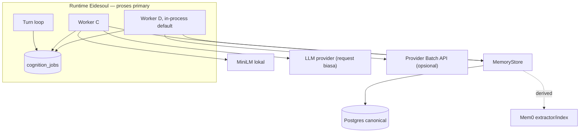
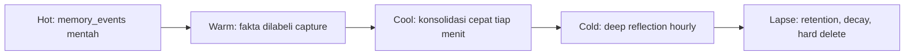

> Terjemahan turunan — jangan sunting; sumber: engine/0003-cognition-worker.md (sha256: c511be6dae02)
> Teks ini ditulis manusia; baris yang tidak bisa diterjemahkan mesin disalin apa adanya ke sumber English, jadi sumber bercampur dua bahasa.

# ADR-0003: Cognition Worker & Model Batching — Batas Gate vs Label

- **Status:** accepted
- **Implementasi:** implemented — bukti: `cognition_jobs` (revisi 5), antrean + worker `eidesoul/engine/cognition.py`, klaim `FOR UPDATE SKIP LOCKED`, reaper, backoff + dead-letter, enqueue intake dalam transaksi yang sama, siklus supervisor, `tests/test_cognition.py`
- **Tanggal:** 2026-11-01
- **Deciders:** Muqsith (owner), omp (reviewer)
- **Konteks:** lanjutan ADR-0001 (canonical + Mem0 adapter) dan ADR-0002 (gate capture + assess batch); rencana memori default-on
- **Supersedes:** —
- **Terkait:** ADR-0001, ADR-0002, ADR-0004 (fallback labeling), ADR-0008 (integritas), ADR-0010 (semantik reflection)
- **Catatan lokasi:** ADR hidup di `docs/v0.1.0/adr/engine/`; salinan Indonesia di `docs/v0.1.0/adr/engine/id/0003-cognition-worker.md`.
- **Amandemen:** 2026-11-02 — normalisasi kerangka (ADR-0009 §4.4): menambah Opsi yang dipertimbangkan; §4→§5 dan penomoran sesudahnya bergeser. 2026-11-03 — audit: rentang `supervisor.py:36-140` diperbaiki menjadi `36-129` (berkas 129 baris). 2026-11-03 — audit: reflection rutin = hourly worker C, Batch API tidak menjadwalkannya; jumlah item/pass milik ADR-0010 §6 (`engine.reflection`), bystander kunci ganda dihapus. 2026-11-03 — `kind='distill'` ditambahkan (ADR-0020): menilai satu episode saat ia ditutup, di worker, bukan di jalur turn.

---

## 1. Konteks

- Jalur real-time sekarang memanggil LLM 4–6 kali per DM: decision, reply + tool loop, `polish`, `regulate`, privacy audit, plus capture di background.
- Memori default-on (ADR-0002) menambah beban ke setiap turn. Kalau semua dikerjakan inline, biaya dan latensi ekor memburuk.
- Tidak ada antrean: capture memakai `spawn()` fire-and-forget tanpa retry, status, atau dead-letter (`agent.py:917-921`).
- Sebagian pekerjaan LLM tidak perlu selesai sebelum balasan terkirim — itulah kandidat batch.
- Ada pula pekerjaan yang **harus** selesai sebelum aksi/ucapan: guard, approval, crisis. Ini tidak boleh ikut di-batch.

## 2. Decision drivers

1. **Keamanan** — apa pun yang berfungsi sebagai gate tidak boleh ditunda.
2. **Biaya** — pekerjaan label dikerjakan berkelompok, bukan per item.
3. **Latensi** — jalur real-time hanya berisi balasan itu sendiri.
4. **Ketahanan** — pekerjaan tidak boleh hilang; ada retry, status, dan dead-letter.
5. **Kesederhanaan operasional** — satu tabel pekerjaan, dua runner.
6. **Isolasi privasi** — batch tidak boleh mencampur scope/orang berbeda.
7. **Observability** — backlog, umur antrean, dan kegagalan terlihat di `/status`.

## 3. Terminologi (mengunci ambiguitas)

| Istilah | Arti |
|---|---|
| **Runtime** | Proses Eidesoul (`eidesoul run`/`console`): supervisor, turn loop, worker |
| **Worker C** | Task in-process di runtime, hanya saat primary; jalur cepat |
| **Worker D** | Runner terjadwal untuk jalur lambat; mulai in-process, bisa terpisah |
| **MiniLM** | Embedder lokal (384-d) di dalam proses; menghitung vektor |
| **LLM** | Model bahasa provider (jauh, HTTP) |
| **Mem0** | Adapter ekstraksi/index di balik port (ADR-0001) |
| **Postgres** | Canonical memory + antrean `cognition_jobs` |
| **Provider Batch API** | Mode eksekusi murah untuk slow lane |

“Pemilik” berarti yang menjalankan dan bertanggung jawab atas lifecycle pekerjaan — bukan yang menghitung.

## 4. Opsi yang dipertimbangkan

Tidak ada alternatif lain yang tercatat secara terpisah saat keputusan diambil; jalur yang dipilih beserta konsekuensinya dibahas langsung di bagian Keputusan.

## 5. Keputusan

### 5.1 Dua jalur



- **Worker C dimiliki runtime**, berjalan hanya saat lease dipegang (primary), berhenti saat freeze/standby.
- **Worker D dimiliki scheduler**; default dijalankan in-process sebagai task terjadwal, dengan pintu keluar ke `eidesoul cognition --slow` (proses/container terpisah) bila dibutuhkan.
- Keduanya memakai **satu tabel pekerjaan** dan **satu pintu tulis** (`MemoryStore`).

### 5.2 Batas gate vs label

| Pekerjaan | Sifat | Keputusan |
|---|---|---|
| Guard `shell`/`sandbox`, approval | Gate sebelum aksi | Deterministik, tetap inline |
| Crisis handling | Gate sebelum ucapan | Deterministik, tetap inline |
| Disclosure L3/L4 | Gate sebelum ucapan | Diganti **pre-filter informasi**: L3/L4 tidak masuk prompt non-DM |
| Privacy auditor LLM | Label setelah draf | Turun jadi batch quality check |
| Memory assess + ekstraksi | Label setelah turn | Worker C |
| Konsolidasi cepat | Label/perapian | Worker C, tiap menit |
| Deep reflection | Pasca | Worker C, **hourly (default)** |
| Backfill, audit massal | Pasca | Worker D + provider Batch API |
| Topic/era digest, currents | Pasca | Worker C |

Prinsip: **kalau harus menahan aksi, jangan di-batch; kalau hanya memberi label, batch.**

### 5.3 Model suhu memori



| Tahap | Isi | Runner |
|---|---|---|
| Hot | `memory_events` mentah, satu transaksi dengan pesan | Tanpa LLM |
| Warm | assess + ekstraksi (fakta, level, subject) | C |
| Cool | gabung duplikat, selesaikan `supersedes` sederhana, jaga index | C, tiap menit |
| Cold | kontradiksi, era/topik, decay, usulan lupa | C, hourly (default) |
| Lapse | retention, hard delete, tombstone audit | Job terjadwal, tanpa LLM |

### 5.4 Antrean tunggal

Tabel `cognition_jobs`:

```sql
cognition_jobs(
  id            uuid primary key,
  kind          text not null,        -- capture | consolidate | reflect | backfill | audit | distill
  scope         text not null,        -- global | person:<id> | chat:<id>
  payload_ref   text not null,        -- referensi ke memory_events
  status        text not null,        -- queued | claimed | done | failed | dead
  claimed_by    text not null default '',
  lease_until   double precision not null default 0,
  attempts      int not null default 0,
  next_attempt_at double precision not null default 0,
  result_ref    text not null default '',
  idempotency_key text not null,
  created_at    double precision not null,
  updated_at    double precision not null,
  unique (idempotency_key)
)
```

- Klaim pekerjaan: `SELECT ... WHERE status='queued' AND next_attempt_at <= now() ORDER BY created_at FOR UPDATE SKIP LOCKED LIMIT n`.
- **Reaper**: `lease_until` lewat → kembalikan ke `queued`.
- Retry dengan backoff; setelah `dead_letter_after` → status `dead`, terlihat di `/status`.
- Idempotency key per pekerjaan; penulisan canonical upsert lewat `MemoryStore`.

### 5.5 Mekanika batching

- Satu request berisi array item dengan `id`; output harus array dengan `id` yang sama.
- Validasi **per item**; item gagal tidak menggagalkan batch; retry per item.
- Ukuran batch dibatasi context window dan output token; chunk bila perlu.
- System prompt batch **stabil** (tanpa `uptime`/`lease` di prefix) supaya prompt caching bekerja.
- **Batch per scope**: jangan mencampur item dari orang/chat berbeda dalam satu request; item L3/L4 tidak ikut batch yang memuat scope lain.
- Worker tidak boleh memblokir event loop: DB dan MiniLM lewat thread/executor.

### 5.6 Provider Batch API

- Dipakai **hanya** untuk slow lane: backfill dan audit massal. Reflection rutin **tidak** lewat sini —
  ia jadwal hourly worker C (ADR-0010 §6).
- Aturan **satu batch outstanding**: submit hanya kalau tidak ada batch berjalan dan backlog melewati threshold.
- Berbasis penyelesaian, bukan jadwal tetap; hasil dipoll, divalidasi per item, lalu ditulis canonical.
- Latensi jam-an, tanpa streaming, format per provider → adapter terpisah di `providers/`, bukan cabang nama provider.
- Default: **`batch_api: off`** sampai jalur utama stabil.

## 6. Konfigurasi

```yaml
memory:
  worker:
    c:
      owner: runtime
      capture:       { max_items: 20, max_wait_seconds: 30 }
      consolidation: { every_seconds: 60, max_items: 100 }
      reflection:    { every_seconds: 3600 }   # jumlah item/pass: ADR-0010 §6 (engine.reflection)
      concurrency: 2
      retry: { attempts: 5, backoff_seconds: 2, dead_letter_after: 5 }
      queue_cap: 5000
    d:
      owner: scheduler
      runner: in_process        # in_process | command
      schedule: nightly         # nightly | weekly
      one_batch_at_a_time: true
      batch_api: off            # off | slow_lane
```

Default yang disepakati: **konsolidasi cepat tiap 60 detik, deep reflection tiap 3600 detik (hourly) via worker C.**

## 7. Konsekuensi

**Positif**

- Jalur real-time hanya berisi balasan; biaya dan latensi turun.
- Pekerjaan tahan restart: status, retry, dead-letter.
- Satu tabel dan satu pintu tulis: C dan D tidak bisa saling menimpa.
- Konsolidasi cepat menjaga memori “panas” tidak menumpuk duplikat.
- Provider Batch API menjadi opsi, bukan ketergantungan.

**Negatif**

- Menambah tabel, worker, reaper, dan metrik.
- Label memori tidak instan; ada jendela antara capture dan konsolidasi.
- Batch per scope lebih kecil sehingga kurang hemat dibanding batch campur.
- `polish`/`regulate` belum diputuskan; jika tetap inline, biaya real-time belum turun maksimal.

**Netral**

- Guard/approval/crisis tetap seperti sekarang; yang berubah hanya auditor dan pekerjaan label.
- Mem0 tetap dipakai sebagai adapter; statusnya derived.

## 8. Metrik dan gate

| Metrik | Target awal |
|---|---|
| Antrean `queued` p95 age (capture) | < 60 detik |
| Rata-rata batch size | > 5 |
| LLM call per item (capture) | ≤ 1 |
| Dead-letter per hari | mendekati 0 |
| Biaya per turn | turun ≥ 50% dibanding inline |
| Late correction | terukur, tren turun |
| Konsolidasi cepat tertunda | < 5 menit |

## 9. Acceptance criteria

- [ ] Tidak ada pekerjaan LLM non-gate di jalur real-time selain balasan.
- [ ] Guard/approval/crisis tetap deterministik dan inline.
- [ ] Auditor tidak lagi menjadi gate; kebocoran dicegah pre-filter L3/L4.
- [ ] Worker tahan restart; item tidak hilang; idempotent; ada dead-letter.
- [ ] Item gagal tidak menggagalkan batch.
- [ ] Batch tidak mencampur scope/orang berbeda.
- [ ] Worker berhenti saat standby/freeze dan tidak memblokir event loop.
- [ ] Konsolidasi cepat berjalan tiap menit dan deep reflection tiap jam (default).
- [ ] Provider Batch API hanya untuk slow lane, satu batch outstanding.
- [ ] Status antrean terlihat di `/status`.

## 10. Risiko dan mitigasi

| Risiko | Mitigasi |
|---|---|
| Late correction | Gate deterministik; koreksi lewat edit/hapus/pesan; jangan untuk aksi fisik |
| Batch poisoning | Validasi per item; provenance; karantina instruksi (ADR-0008) |
| Kontaminasi antar-item | Batch per scope; larang campur L3/L4 |
| Antrean menumpuk | Backpressure: degrade ke metadata-only + alert |
| Biaya reflection lari | Budget per putaran; skip kalau tidak ada perubahan |
| Batch API menumpuk/kedaluwarsa | Satu batch outstanding; berbasis penyelesaian |
| Dua runner saling menimpa | `SKIP LOCKED` + lease + reaper + idempotency |

## 11. Interaksi dengan ADR lain

- **ADR-0001** — canonical store dan outbox menjadi tujuan tulis.
- **ADR-0002** — gate dan assess menjadi pekerjaan `kind=capture`.
- **ADR-0004** — perilaku saat assess gagal (drop/provisional/stub).
- **ADR-0006** — pre-filter L3/L4 untuk grup.
- **ADR-0008** — provenance/trust dan anti-poisoning.
- **ADR-0010** — semantik deep reflection (grounding, audit, budget) — **accepted** (`ADR-0010-reflection-disputed.md`): pekerjaan `kind=reflect`, satu scope per pass, `refs` wajib, `derive_depth: 1`, anggaran per pass/hari.

## 12. Referensi kode

- `eidesoul/engine/agent.py:917-921` — `spawn()` capture tanpa retry.
- `eidesoul/engine/privacy.py:141-214` — `review` (auditor) sebagai gate saat ini.
- `eidesoul/engine/guard/policy.py:200-213` — policy deterministik yang tetap inline.
- `eidesoul/engine/tools/__init__.py:182-240` — satu pintu eksekusi tool.
- `eidesoul/engine/supervisor.py:36-129` — lifecycle primary/standby yang menjadi induk worker C.
- `eidesoul/engine/stores/affect.py` — pola worker/state document yang bisa ditiru.
- `eidesoul/engine/config.py:130-138` — `MemoryConfig` untuk knob worker.

---

*ADR ini disimpan di `docs/v0.1.0/adr/engine/0003-cognition-worker.md`.*
