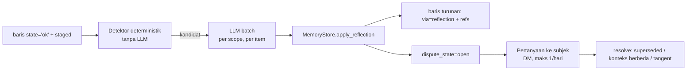

> Terjemahan turunan — jangan sunting; sumber: engine/0010-reflection-disputed.md (sha256: 13b4c457a77c)
> Teks ini ditulis manusia; baris yang tidak bisa diterjemahkan mesin disalin apa adanya ke sumber English, jadi sumber bercampur dua bahasa.

# ADR-0010: Reflection, Kontradiksi & Status `disputed`

- **Status:** accepted
- **Implementasi:** implemented — bukti: refleksi terjadwal (`cognition.py`), `dispute_state` + `mark_disputed`/`resolve_dispute`/`stale_disputes`, derivasi satu level di T2, baris bersengketa tersembunyi, batas `questions_per_day` (`disputes_asked_today`/`mark_dispute_asked`) dengan satu pertanyaan DM per pass (`Agent.ask_dispute`, `HistoryStore.dm_thread`), `tests/test_reflection.py`, `tests/test_agent.py`; gate: `pytest -q` 831 lulus, `scripts/adr.py --check`
- **Tanggal:** 2026-11-02
- **Deciders:** Muqsith (owner), omp (reviewer)
- **Konteks:** melunasi utang ADR-0008 §4.9C (`disputed` ditunda ke sini) dan menutup slot terakhir antrean ADR-0001 §14
- **Supersedes:** —
- **Terkait:** ADR-0003 (worker & antrean), ADR-0004 (state `staged`), ADR-0005 (TTL/renewal), ADR-0006 (privasi grup), ADR-0007 (kelas izin), ADR-0008 (integritas), ADR-0013 (turn lifecycle), ADR-0014 (automation), ADR-0015 (payload), ADR-0019 (`llm_calls`), ADR-0020 (prosedur turunan)
- **Amandemen:** 2026-11-03 — audit: path rujukan `capture_turn` diperbaiki menjadi `eidesoul/engine/access/privacy.py:222-303` (`memory/privacy.py` 71 baris, hanya `show`/`disclose`). 2026-11-03 — ambang promosi `staged` dinyatakan sebagai jumlah baris (≥2 baris `ok`), dibedakan dari ambang hari `corroboration_days` (ADR-0008); daftar `state` menunjuk ADR-0004 §5.1/enum ADR-0016. 2026-11-03 — audit: `refs`/`derive_depth`/`dispute_state` di §Referensi diberi label usulan (belum ada di repo).
- **Catatan lokasi:** ADR hidup di `docs/v0.1.0/adr/engine/`; salinan Indonesia di `docs/v0.1.0/adr/engine/id/0010-reflection-disputed.md`.

---

## 1. Konteks

**Reflection belum ada wujudnya.** Di seluruh `eidesoul/engine` tidak ada satu pun modul reflection:
`grep -iE 'reflect|rumina'` hanya menemukan `ambient.py:1` yang menyebut “summarise topics and
research while idle”. Yang benar-benar berjalan sekarang adalah `Ambient` — loop latar yang, saat
sebuah chat menganggur, membuat digest topik dan riset `web_search`, lalu menulis baris
`scope=chat, kind=note, source=ambient:<thread_id>` (`ambient.py:203-315`), dan **tidak pernah mengirim
pesan ke chat mana pun** (`ambient.py:1-4`). ADR-0003 sudah menetapkan tempatnya: pekerjaan
`kind=reflect` di tabel `cognition_jobs`, jalur dingin, default **hourly**, dijalankan Worker C yang
memegang lease. Slotnya kosong; bentuknya belum diputuskan — di sini.

**Kontradiksi hari ini tidak punya pemilik.** ADR-0008 memutuskan anti-poisoning A (kuota), B/B2
(supersede berbukti), dan D (promosi ketat), lalu **menunda** penandaan kontradiksi: “Menandai
kontradiksi butuh deteksi yang sifatnya batch” (ADR-0008:180) dan menyerahkannya ke ADR ini
(ADR-0008:281, :297). Akibat yang berlaku sekarang: dua baris saling bertentangan bisa **dua-duanya
`state='ok'`**, dua-duanya masuk prompt, dan soul harus memilih sendiri — nondeterministik, dan
justru pada kasus yang paling mahal salah.

**Grounding sudah ditetapkan tapi belum ditegakkan.** ADR-0008:187 menyatakan “Reflection hanya boleh
menyimpulkan dari baris canonical yang `state='ok'`”. Tanpa mekanisme, aturan itu hanya kalimat:
tidak ada `refs` wajib, tidak ada batas kedalaman turunan, tidak ada anggaran tulis.

**`staged` menunggu peninjau.** ADR-0004 dan ADR-0008 membuat `staged` (berlabel, tidak terbaca, TTL
ikut `kind`, promosi lewat recall-miss). Peluang promosinya baru satu jalur; tidak ada yang meninjau
`staged` secara batch, dan tidak ada yang menjawab: kalau dua baris `staged` saling bertentangan,
siapa yang naik?

**Yang harus dihindari sejak awal:** reflection yang mengarang, reflection yang mengutip dirinya
sendiri sampai memperkuat halusinasi, dan reflection yang berubah menjadi obrolan — bertanya ke
pengguna tentang hal-hal yang tidak penting.

## 2. Decision drivers

1. **Deterministik dulu, LLM hanya untuk sisa yang tak terklasifikasi** — pola yang sudah dipakai
   guard (ADR-0008) dan di sini dipakai untuk deteksi kontradiksi.
2. **Setiap tulisan turunan bisa dilacak** ke baris sumbernya; tanpa sumber, tidak ditulis.
3. **Nol amplifikasi** — turunan tidak boleh menjadi bahan turunan berikutnya tanpa batas.
4. **Satu penulis** — semua tulisan tetap lewat `MemoryStore`; tidak ada jalur tulis kedua.
5. **Tidak mengganggu turn** — reflection latar tidak pernah memblokir balasan (ADR-0013).
6. **Pertanyaan ke pengguna itu mahal** — paling banyak satu per orang per hari, hanya di DM.
7. **Biaya terlihat dan bisa dimatikan** — anggaran eksplisit, kill switch, status di `/status`.
8. **Privasi tidak turun sendiri** — level turunan tidak boleh lebih rendah dari sumbernya; level
   tidak pernah diturunkan oleh proses otomatis.

## 3. Opsi yang dipertimbangkan

| Opsi | Bentuk | Kelebihan | Kekurangan | Status |
|---|---|---|---|---|
| **A. Tidak ada reflection** | Biarkan kontradiksi hidup berdampingan | Nol biaya, nol kode | Soul memilih sendiri di prompt; `staged` tak pernah ditinjau; `disputed` selamanya utang | Ditolak |
| **B. Deteksi per-capture inline** | Setiap capture memanggil LLM untuk cek kontradiksi | Paling cepat terdeteksi | Satu panggilan LLM ekstra per pesan; biaya linier dengan trafik; melanggar prinsip “label boleh di-batch” (ADR-0003 §5.2) | Ditolak |
| **C. Reflection batch + deteksi deterministik dulu + `disputed` bertingkat** | Jalur dingin per scope, kandidat kontradiksi dari aturan deterministik, LLM hanya memutus kandidat, keluaran wajib ber-`refs`, dispute diselesaikan lewat subjek di DM | Biaya terkendali; bisa dilacak; tidak mengganggu turn; `staged` ikut ditinjau | Perlu atribut baru (`refs`, `derive_depth`, `dispute_state`) dan jalur tanya di DM | **Dipilih** |
| **D. Serahkan ke Mem0/inferensi provider** | Biarkan lapisan memori pihak ketiga menyelesaikan konflik | Nol kode | Tidak ada kontrak yang bisa diuji; keputusan privasi tidak boleh diserahkan ke pihak ketiga | Ditolak |

## 4. Keputusan

> **Reflection adalah pekerjaan batch jalur dingin per scope yang hanya membaca baris `state='ok'`,
> menulis hanya dengan `refs` ke baris sumber, dibatasi kedalaman turunan satu tingkat dan kuota
> tulis, mendeteksi kontradiksi secara deterministik lalu meminta LLM memutus kandidatnya, menandai
> pasangan yang benar-benar bertentangan sebagai `disputed`, dan menyelesaikannya lewat subjek — di
> DM, paling banyak sekali sehari.**



### 4.1 Apa yang dikerjakan reflection — dan apa yang bukan

**Dikerjakan (v1):**

| Pekerjaan | Keluaran |
|---|---|
| Konsolidasi semantik | Gabung duplikat lintas turn/chat yang sudah ada, `refs` menunjuk semua sumber |
| Kontradiksi | Pasangan baris yang saling bertentangan → `dispute_state='open'` |
| Tinjauan `staged` | Promosi ke `ok` bila dikuatkan ≥2 baris `ok`; penurunan bila terlibat dispute; sisa mengikuti TTL |
| Ringkasan era/topik | Ringkasan yang **ber-`refs`**, bukan cerita baru |
| Usulan lupa | Usulan ke jalur retention (ADR-0005), bukan penghapusan langsung |

**Bukan pekerjaan reflection:**

- mengubah persona, `soul`, atau `kind=rule` — batas keras ADR-0008 §4.4 (`self_stated` + dokumen soul
  saja);
- mengirim pesan ke chat (sama seperti `Ambient`, `ambient.py:1-4`);
- menurunkan level privasi, membuka `secret`, atau menyentuh level 5/kredensial;
- menghapus baris — penghapusan tetap milik retention/`/memori` dengan hak subjek;
- menilai kebenaran dunia luar (itu tugas `web_search`, dan hasilnya masuk sebagai fakta bersumber).

### 4.2 Pemicu

| Pemicu | Syarat | Catatan |
|---|---|---|
| Terjadwal | `reflect_every_minutes: 60` (default hourly, ADR-0003 §5.3) | Hanya saat lease dipegang primary; standby beku (ADR-0012) |
| Backlog | ≥ `reflect_min_new_rows: 25` baris `ok` baru di scope itu sejak pass terakhir | Mencegah pass kosong |
| Menganggur | Tidak ada pesan masuk di scope selama `reflect_idle_minutes: 30` | Berbeda dari `Ambient`: `Ambient` meringkas topik chat, reflection bernalar atas memori canonical |
| Eksplisit | Langkah `queue_reflection` automation (ADR-0014 §4.5) atau permintaan pemilik | Automation hanya **mengantre**, tidak menulis hasil |

Satu pass memproses **satu scope** (`max_scopes_per_pass: 1`) dan tidak mencampur scope dalam satu
request — aturan yang sama dengan batching capture (ADR-0003 §5.5).

### 4.3 Grounding: keluaran wajib menunjuk sumber

Setiap baris yang ditulis reflection:

- `via: reflection` — asal-usul eksplisit (ADR-0008 §4.1);
- `refs: [<id baris sumber>, …]` — **wajib, tidak boleh kosong**. Tanpa sumber, item dibuang, bukan
  ditulis dengan sumber kosong;
- `stated_by`/`about` **diwarisi** dari sumber terkuat, bukan disimpulkan ulang;
- `level` = **maksimum** level sumber; reflection tidak pernah menurunkan level;
- `kind` mengikuti kategori sumber (gabungan duplikat tetap `kind` asalnya), dan `commitment` tetap
  membawa `due_at` + status (ADR-0008 §4.4B3);
- `derive_depth: 1` (lihat 4.4);
- `trust: T2` — petunjuk, bukan aturan (ADR-0008 §4.5): turunan tidak pernah mengikat perilaku, tidak
  bisa naik ke Tier 1, dan tidak bisa mempromosikan dirinya sendiri; `state` dan trust adalah dua
  sumbu terpisah, jadi `state='ok'` + `trust=T2` itu sah;
- `asserted_at` = waktu pass, bukan waktu sumber.

Semua baris turunan langsung **`state='ok'`** (informasinya nyata dan bersumber), kecuali yang
diperdebatkan → tetap `ok` + `dispute_state='open'`, dan **hanya** boleh dipakai sebagai konteks,
tidak untuk perilaku (batas keras T0 di ADR-0008 tetap berlaku dan sudah menutup jalur itu).

### 4.4 Batas kedalaman & anti-amplifikasi

| Aturan | Nilai | Alasan |
|---|---|---|
| Kedalaman turunan | `derive_depth: 1` — reflection **tidak** membaca baris `via=reflection` untuk menghasilkan turunan baru | Mencegah penguatan diri sendiri: ringkasan dari ringkasan cepat menjauh dari sumber |
| Kuota tulis turunan | Bagian dari kuota per orang (ADR-0008 §4.4A), `reflect_quota_share: 0.25` | Tulisan turunan tidak boleh memakan kuota pernyataan pengguna |
| Larangan bentuk | `kind=rule` dari reflection: **0** — rule hanya `via=soul_doc` (ADR-0008 §4.3) | Aturan hanya dari dokumen soul; reflection atas memori tidak punya jalur |
| Batas per pass | `max_writes_per_pass: 20` | Membatasi ledakan biaya/volume |
| Idempotensi | Satu window per scope; pass ulang atas window yang sama tidak menulis baris baru | Lihat 4.9 |

Reflection boleh **memperbarui** baris turunan yang sudah ada (menambah `refs`, memperbarui ringkasan)
lewat supersede berbukti (ADR-0008 §4.4B), tetapi tidak membuat turunan dari turunan.

### 4.5 Deteksi kontradiksi: deterministik dulu, LLM kemudian

**Lapisan 1 — deterministik (selalu jalan, tanpa LLM).** Kandidat dipilih dari baris `state='ok'`
dengan `scope`, `subject_id`, dan `kind` sama, bila salah satu terpenuhi:

- polaritas berlawanan pada predikat yang sama (`suka` vs `tidak suka`, `aktif` vs `berhenti`) memakai
  leksikon polaritas yang sudah ada di jalur guard;
- nilai saling meniadakan: angka, tanggal, atau `due_at` berbeda untuk klaim yang sama;
- keadaan saling meniadakan: `done` vs `pending` untuk `commitment` yang sama;
- lokasi/jam yang mustahil bersamaan untuk klaim rutin yang sama.

Lapisan ini murah, deterministik, dan **tidak menandai apa pun** — ia hanya mengumpulkan kandidat.

**Lapisan 2 — LLM (hanya kandidat).** Batch per scope memutus: `contradiction`, `contextual`
(dua-duanya benar di konteks berbeda), atau `unrelated`. Prompt batch stabil (tanpa `uptime`/`lease`)
supaya prompt caching bekerja (ADR-0003 §5.5). Item yang gagal tidak menggagalkan batch; ia diulang.

**Batas ambang.** Kandidat hanya diproses bila `reflect_min_candidates: 1` di scope itu; tidak ada
pass yang hanya berisi satu-dua baris kecuali dipicu eksplisit.

### 4.6 `disputed`: bentuk data dan efek baca

`disputed` **bukan** nilai `state` baru. `state` tetap enam nilai ADR-0004 §5.1 (`pending`, `ok`,
`staged`, `failed`, `not_worth`, `superseded`; enum resmi di ADR-0016 §4.3), sehingga invariant
“hanya `state='ok'` yang bisa dibaca” tidak berubah.
Yang bertambah adalah metadata pada baris:

| Atribut | Nilai |
|---|---|
| `dispute_state` | `none` \| `open` \| `resolved` \| `stale` |
| `disputed_with` | id baris lawan |
| `dispute_reason` | `deterministic:<rule>` \| `llm:<label>` |
| `dispute_opened_at`, `dispute_asked_at`, `dispute_resolved_at` | timestamp |

Efek baca:

- `dispute_state='open'` **tetap bisa dibaca** (informasinya belum salah, cuma belum diputus) dan
  dirender dengan penanda, memakai konvensi `?` yang sudah ada untuk baris belum dikonfirmasi
  (`commands/memori.py`: `mark = "" if hit.confirmed else "?"`) → dispute memakai penanda tambahan
  `!` pada jalur tampilan yang sama;
- pasangan `open` **tidak boleh** dipakai untuk perilaku: tidak masuk Tier 1, tidak menjadi prosedur,
  tidak menjadi preferensi yang mengikat — persis batas keras ADR-0008;
- dispute **tidak memperpanjang TTL** (ADR-0005 tetap berlaku apa adanya); menandai bukan memakai.

### 4.7 Resolusi lewat subjek

| Langkah | Aturan |
|---|---|
| Siapa yang ditanya | `subject_id` dispute; kalau tidak diketahui, `owner_id`. Bukan pihak ketiga, bukan grup |
| Di mana | **Hanya DM.** Di grup tidak ada pertanyaan privasi (ADR-0006) dan dispute tidak disinggung |
| Berapa sering | `max_dispute_questions_per_day: 1` per orang; pertanyaan kedua menunggu hari berikutnya |
| Bentuk | Satu pertanyaan ringkas dengan dua kutipan pendek + 2-3 pilihan (“yang mana yang berlaku?”), bukan wawancara |
| Jawaban “yang A” | Baris B → `superseded` bertanggal dengan sebab `dispute_resolved`, A bertahan dan boleh dikonfirmasi |
| Jawaban “dua-duanya, beda konteks” | Keduanya bertahan, `dispute_state='resolved'`, scope/konteks dipersempit bila mungkin |
| Jawaban “dua-duanya salah” | Keduanya → `superseded` oleh pernyataan baru; pernyataan baru ditangkap jalur normal |
| Tidak dijawab | Setelah `dispute_ttl_days: 30` → `dispute_state='stale'`, baris dengan provenance lebih lemah turun ke `staged` (masih hidup, bisa dipromosikan); bila setara, keduanya bertahan dengan penanda |
| Veto | Veto subjek (jalur consent ADR-0007/ADR-0005) selalu menang: baris hilang dari retrieval, dispute ditutup |
| Otomatis | Automation **tidak** boleh menyelesaikan dispute; hanya pengantre pass (ADR-0014) |

Jawaban subjek ditangkap sebagai pernyataan biasa (`via=turn`), jadi kepercayaannya penuh — bukan
reflection yang menaikkannya.

### 4.8 Tinjauan `staged`

Pass yang sama meninjau `staged` di scope itu:

1. **Promosi** ke `ok` bila dikuatkan ≥2 baris `ok` yang berbeda (`refs` terisi) atau bila recall-miss
   mengangkatnya; promosi tetap tunduk pada ADR-0004/ADR-0008. Ambang ini dihitung sebagai **jumlah
   baris**, bukan hari — ambang hari (`corroboration_days: 2`, ADR-0008) hanya berlaku untuk promosi
   trust, bukan untuk keluar dari `staged`.
2. **Penurunan**: baris `ok` yang terlibat dispute dan kalah → `staged` (bukan dihapus), dengan TTL
   mengikuti `kind`;
3. **Pembersihan**: `staged` yang melewati TTL dibuang sesuai ADR-0004/ADR-0005 — reflection tidak
   memperpanjang umur apa pun kecuali lewat re-evidence yang sah.

### 4.9 Satu penulis & idempotensi

- Semua tulisan lewat **satu pintu**: `MemoryStore.apply_reflection(...)` di `memory/mem0.py`, memakai
  jalur metadata + supersede yang sudah ada (`mem0.py:340-392`, `:323-338`). Tidak ada tulis langsung
  ke tabel Mem0 dari worker.
- Kunci idempotensi per pass: `reflect:<scope>:<window_start>`; pass ulang atas window yang sama
  menghasilkan nol baris baru meski proses mati di tengah.
- Validasi **per item** sebelum menulis: `refs` tidak kosong, sumber masih `state='ok'` dan masih bisa
  dibaca oleh penulis (tidak memuat scope yang bukan haknya), level turunan ≥ maksimum level sumber.
  Item yang gagal dibuang, dilaporkan di `/status`, bukan ditulis setengah.
- Worker C dan Worker D memakai fungsi yang sama sehingga jalur Batch API (ADR-0003 §5.6) tidak bisa
  menyelundupkan tulisan yang tidak melewati validasi.

### 4.10 Anggaran, kill switch, dan keterlihatan

- Anggaran per pass: `max_items_per_pass: 40`, `max_writes_per_pass: 20`,
  `max_seconds_per_pass: 60`. Melewati batas → pass berhenti rapi, sisanya menunggu pass berikutnya.
- Anggaran per hari per scope: `max_passes_per_day: 24` (hourly) dan pengali biaya terlihat di
  `/status`.
- Kill switch: `reflection.enabled: false` menghentikan pass baru; baris hasil lama tetap berlaku,
  dispute `open` dibiarkan bertahan (bukan ditutup paksa) dan pertanyaan tidak dikirim.
- Keterlihatan: `/status` menampilkan jumlah pass, tulisan, dispute dibuka/diselesaikan/di-`stale`,
  dan pertanyaan yang dikirim — angka, bukan narasi.
- Tanpa LLM (`llm is None`) reflection tidak berjalan sama sekali; tidak ada jalur cadangan yang
  menebak. Lapisan deterministik ada di `eidesoul/engine/memory/reflect.py`; pembungkus CLI manual belum dibuat.
  untuk memeriksa kandidat tanpa menulis apa pun.

## 5. Konfigurasi

```yaml
engine:
  reflection:
    enabled: true
    every_minutes: 60          # pass terjadwal (default hourly, ADR-0003 §5.3)
    idle_minutes: 30           # pemicu menganggur, terpisah dari ambient.idle_minutes
    min_new_rows: 25           # backlog minimum agar pass dijalankan
    min_candidates: 1          # kandidat minimum agar LLM dipanggil
    scopes_per_pass: 1
    items_per_pass: 40
    writes_per_pass: 20
    seconds_per_pass: 60
    passes_per_day: 24
    derive_depth: 1            # turunan dari turunan: dilarang
    quota_share: 0.25          # porsi kuota tulis per orang (ADR-0008 A)
    dispute_ttl_days: 30
    questions_per_day: 1       # per subjek, hanya DM
    batch_api: off             # jalur lambat opsional (ADR-0003 §5.6)
```

Kunci ini bagian dari dokumen `engine` (seed `config.yaml`, mirror di DB); mengubahnya manual → 
`eidesoul config import`.

## 6. Metrik dan gate

| Metrik | Target awal |
|---|---|
| Tulisan turunan tanpa `refs` | 0 (diuji) |
| Baris `via=reflection` dengan `derive_depth > 1` | 0 (diuji) |
| `kind=rule` yang ditulis reflection | 0 (diuji) |
| Level turunan lebih rendah dari sumber | 0 (diuji) |
| Pertanyaan dispute di grup | 0 (diuji) |
| Pertanyaan dispute melebihi `questions_per_day` | 0 |
| Dispute terbuka tanpa resolusi setelah TTL | 0 (menjadi `stale`) |
| Pass melewati `writes_per_pass`/`seconds_per_pass` tanpa berhenti rapi | 0 |
| Kandidat deterministik → putusan LLM (`contradiction`/`contextual`/`unrelated`) | ≥ 90% terputuskan, sisanya `unrelated` |

## 7. Acceptance criteria

- [ ] `reflection.enabled: true` menjalankan pass per scope tanpa memblokir turn; `false` menghentikan pass baru tanpa mengubah baris lama.
- [ ] Setiap baris turunan punya `via=reflection` dan `refs` tidak kosong; tanpa `refs`, item dibuang dan dilaporkan.
- [ ] `stated_by`/`about` diwarisi dari sumber; `level` turunan = maksimum level sumber; tidak ada penurunan level otomatis.
- [ ] Reflection tidak membaca baris `via=reflection` untuk menghasilkan turunan baru (`derive_depth: 1` ditegakkan validasi).
- [ ] Detektor deterministik mengumpulkan kandidat tanpa LLM; LLM hanya menerima kandidat, batch per scope, prompt stabil.
- [ ] `disputed` tidak menambah nilai `state`; invariant “hanya `state='ok'` yang bisa dibaca” tetap utuh; baris dispute `open` tetap terbaca dengan penanda `!` dan tidak bisa dipakai untuk perilaku.
- [ ] Pertanyaan dispute hanya dikirim di DM, maksimum `questions_per_day` per subjek, dengan dua kutipan dan pilihan jawaban.
- [ ] Jawaban subjek masuk lewat jalur capture biasa (kepercayaan penuh), bukan dinaikkan oleh reflection.
- [ ] Dispute melewati TTL menjadi `stale`; baris dengan provenance lebih lemah turun ke `staged`.
- [ ] `staged` ditinjau: promosi bila dikuatkan ≥2 baris `ok`, penurunan saat kalah dispute, sisanya mengikuti TTL.
- [ ] Semua tulisan lewat `MemoryStore.apply_reflection` dengan kunci idempotensi `reflect:<scope>:<window_start>`; pass ulang tidak menghasilkan baris baru.
- [ ] Anggaran per pass dan `passes_per_day` ditegakkan; melewati batas berhenti rapi, bukan dipotong diam-diam.
- [ ] `/status` menampilkan angka pass/tulisan/dispute/pertanyaan; tidak ada narasi.
- [ ] CLI manual `reflect --dry-run` menampilkan kandidat dan rencana tulisan **tanpa menulis apa pun** (read-only, pola `scripts/ablate.py`).

## 8. Risiko dan mitigasi

| Risiko | Mitigasi |
|---|---|
| Reflection mengarang fakta | `refs` wajib + tanpa sumber dibuang; sumber harus `state='ok'`; `stated_by`/`about` diwarisi |
| Amplifikasi diri sendiri | `derive_depth: 1`; reflection tidak membaca keluarannya sendiri |
| Biaya LLM meledak | Kandidat deterministik dulu; batch per scope; `items_per_pass`/`writes_per_pass`/`seconds_per_pass`; `passes_per_day` |
| Reflection menyalahkan orang | Turunan `about` diwarisi, level tidak turun, dan `disputed` hanya soal kontradiksi data — bukan penilaian orang; pertanyaan hanya ke subjek |
| Pertanyaan menjadi wawancara | `questions_per_day: 1`, satu pertanyaan berisi dua kutipan + pilihan, hanya di DM |
| Dispute menggantung selamanya | `dispute_ttl_days: 30` → `stale` + turunkan yang lemah ke `staged` |
| TTL jebol karena dispute | Dispute tidak memperpanjang TTL (ADR-0005 tetap) |
| Dua penulis bersaing | Satu pintu `apply_reflection`, satu antrean `cognition_jobs`, klaim `SKIP LOCKED` + lease (ADR-0003, ADR-0012) |
| `staged` menumpuk tanpa tinjauan | Pass yang sama meninjau `staged`: promosi, penurunan, atau dibuang menurut TTL |
| Reflection menghidupkan kembali data yang sudah di-veto | Veto selalu menang dan dispute ditutup; pass membaca only-`ok` yang sudah lewat funnel privasi |
| Fitur dimatikan lalu soul menebak | Saat `enabled: false`, `/status` menyatakannya; tidak ada penebakan di jalur lain |

## 9. Interaksi dengan ADR lain

- **ADR-0003** — reflection adalah pekerjaan `kind=reflect` di `cognition_jobs` (jalur dingin Worker C,
  default hourly); Batch API hanya untuk jalur lambat dan wajib lewat validasi yang sama.
- **ADR-0004** — `state` tidak bertambah nilai; `staged` ditinjau di sini (promosi/penurunan/TTL).
- **ADR-0005** — dispute tidak memperpanjang TTL; renewal tetap berbasis hit; usulan lupa dari
  reflection hanya usulan.
- **ADR-0006** — tidak ada pertanyaan privasi di grup; dispute hanya dibahas di DM subjek.
- **ADR-0007** — pertanyaan dispute masuk kelas consent (memori subjek sendiri); veto selalu menang;
  automation tidak boleh menyelesaikan dispute.
- **ADR-0008** — `disputed` melunasi §4.9C; batas keras trust T0 tetap; `refs` memperkuat jalur bukti B/B2;
  turunan reflection selalu `trust=T2` (§4.5 di sana) sehingga tidak pernah mengikat perilaku; reflection
  tunduk pada kuota A.
- **ADR-0019/ADR-0020** — pass ini adalah tempat perbandingan efisiensi antar-episode
  (ADR-0020 §4.8) dijalankan: bahan angkanya `llm_calls` (ADR-0019) dan `turn_steps` (ADR-0013).
  Aturan pembandingnya milik ADR-0020; reflection hanya menyediakan jadwal dan anggaran.
- **ADR-0011/ADR-0012** — pass memakai klaim `SKIP LOCKED` + lease; standby tidak menjalankan reflection.
- **ADR-0013** — reflection tidak pernah memblokir turn; turn yang sedang berjalan tidak menunggu pass.
- **ADR-0014** — langkah `queue_reflection` hanya mengantre pass; tidak ada tulis langsung dari automation.
- **ADR-0015** — status reflection tampil lewat `/status` dan topik `batas` (angka kasar), bukan payload
  biasa; `refs`/id baris tetap tidak masuk prompt pengguna.

## 10. Referensi kode

- `eidesoul/engine/ambient.py:1-4`, `:103-200`, `:203-315` — loop menganggur yang ada; batas “tidak pernah
  mengirim pesan” dan bentuk tulisan `scope=chat, kind=note, source=ambient:<thread_id>`.
- `eidesoul/engine/config.py:236-252` — `AmbientConfig` (preseden kunci anggaran: `tick_seconds`,
  `idle_minutes`, `research_per_day`).
- `eidesoul/engine/memory/mem0.py:340-392` — jalur metadata; `refs`, `derive_depth`, `dispute_state`
  **usulan** (belum ada di repo; kolomnya di ADR-0016 §4.2). `:323-338` — supersede berbukti (ada).
- `eidesoul/engine/access/privacy.py:222-303` — `capture_turn` (jalur masuk jawaban subjek);
  `eidesoul/engine/memory/privacy.py:52-71` — `show`/`disclose`.
- `eidesoul/engine/memory/context.py:91-133` — `render`/`build` (tempat penanda dispute ikut dirender).
- `eidesoul/engine/commands/memori.py:15-23` — penanda `?` untuk baris belum dikonfirmasi (konvensi
  tampilan yang diperluas oleh `!`).
- `eidesoul/engine/tools/memory.py` — tool aksi sadar (tetap jalur utama untuk “ingat/lupakan”).
- `eidesoul/engine/commands/status.py` — tempat angka pass/tulisan/dispute/pertanyaan ditampilkan.
- `eidesoul/engine/guard/patterns.py:11-26` — leksikon/pola yang dipakai lapisan deterministik.
- `scripts/ablate.py:1-8` — preseden harness read-only; `scripts/replay.py:1-12` — harness skenario
  ber-rubric untuk menilai mutu pass reflection.
- ADR-0003 §5.3-5.6 — antrean `cognition_jobs`, batching per scope, jalur Batch API.

---

*ADR ini disimpan di `docs/v0.1.0/adr/engine/0010-reflection-disputed.md`.*
